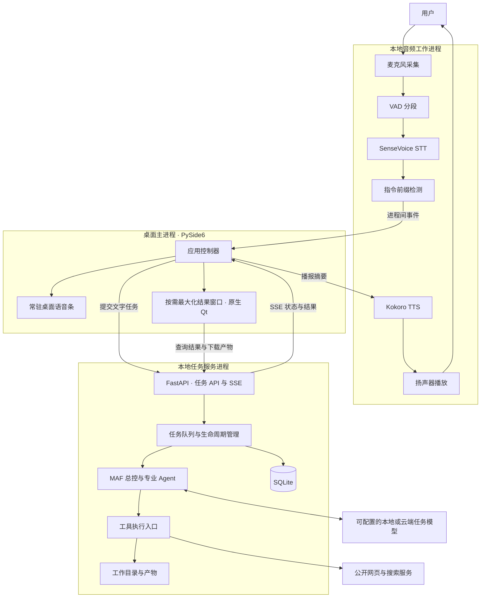
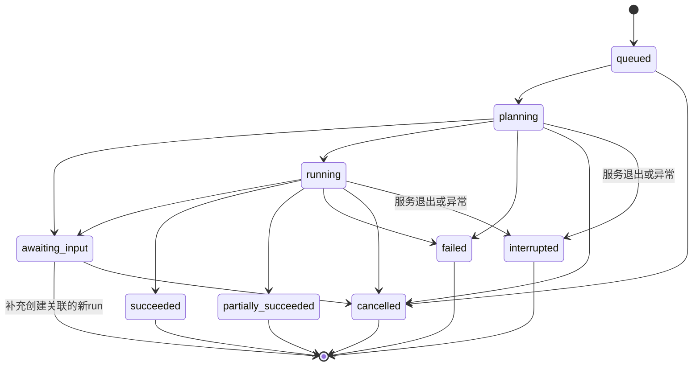

# open-JARVIS

<p align="center">
  
</p>

一个面向个人工作自动化的桌面语音智能体。平时只显示一个常驻桌面的语音条；用户说出任务后，JARVIS 在后台完成资料检索、文档撰写或数据分析，随后开口反馈，并打开最大化窗口展示结果。

**首版发布目标：macOS Intel（x86_64）、macOS Apple Silicon（arm64）、Windows 64 位（x86_64）。** 三种目标均交付可安装客户端，不要求最终用户自行安装 Python。

**实现原则：以性能作为第一性原则。** 常驻开销、交互延迟与资源可回收性是架构约束和发布门槛，从第一阶段测量；既有原型、框架和组件选择都必须接受验证。正确性、语音可用性和数据完整性仍须同时满足。

> **当前版本：0.1.0 开发预览，2026-10-31。**
> 已实现原生桌面、持久化任务、MAF 专业 Agent 编排及本地 STT/TTS 管线；下文保留整体架构和发布验收要求。三端原生 CI 与未签名安装包构建已通过；真实音频设备、签名安装和性能预算尚未完成验收，当前是公开预览版。详细证据见 [验证记录](docs/VALIDATION.md)。

## 桌面语音条与模型管理

桌面入口为 **圆形山羊 Logo → 实际声浪 → 展开图标** 的 264×56 胶囊形语音条，两端圆润。点击中间声浪暂停/继续接听，右侧图标最大化结果窗口，避免主动进入 macOS 全屏 Space；拖动语音条或按钮只移动位置。声浪跟随实际音量，静音/暂停/播报时归零。模型直接在设置的语音识别、语音合成两行点击「下载」，原处显示进度和预计剩余时间，完成后自动加载；兼容的已下载模型可跨客户端版本复用。

[新版界面截图与续传验收](docs/validation/workbench-resume-2026-10-31/README.md)。本地 **362 项测试通过**；最新源码包含浅色工作空间、主动查看回复、后台播报、模型换源续传，以及加宽的设置页与 ⓘ 厂商帮助。下方 **alpha.10** 三端安装包包含这些功能、连续会话、输入框语音转写、工具目录和网页读取改进，保留下载进度与 MAF 修复；原生 CI 和打包后的实际 MAF 任务自检均通过。

## 工作空间与后台播报

主页面采用浅色侧栏、白色文件区和圆角控件，默认展示任务状态与实际生成文件。完整的智能体文字回复收进「查看回复」，只有用户主动打开才解析显示；切换任务后重新收起。文件预览和后台语音播报独立，浏览另一项任务不会打断正在播报的回答，也不会清空播报队列。

输入框旁的「添加资料」用于把本地工作资料放入任务工作区，供 JARVIS 读取或分析。目前支持 CSV、TXT、Markdown、JSON，单文件不超过 2 MB。生成的 Word、Excel、PPT、视频等在文件区预览，可点击「保存文件」保存完整文件。

## 连续对话、语音转写与工具目录

以下功能已包含在公开发布的 alpha.10 三端安装包中。

一段对话是一个持久化 **session**，每次输入到本轮回答是一个 **run**。左栏可以新建或切换对话，并查看其中各轮结果；日常发送、补充问题、暂停聆听和重启都不会自动新建 session。点击「新建对话」或完整说出「新建对话」才创建新会话，旧问答和产物记录继续保留。旧数据库会自动归档迁移。`run_id` 沿用 `task_id`，兼容已有文件和事件接口。

默认先说一次「贾维斯」唤醒，之后可以连续接着说，直到点击暂停；恢复聆听后重新唤醒。TTS 暂停收音和切换对话不会要求每句话重复唤醒。语音临时识别文字直接出现在输入框，停顿约 900 ms 完成一句后自动发送最终文字。临时文字只作预览，可能纠错；不会在每次更新时发送。手动草稿保留，提交失败保留识别文字以便重试。切换对话会丢弃当前未发送语音，避免发入另一段对话。

右上角扳手图标显示实际工具目录：中文说明、所属助手、用途和参数，按需加载，不启动模型。MAF 模式提供 18 个工作工具与 4 个专业助手委派入口；目录来自真实注册定义，跟随工具参数更新。

网页读取 `fetch_page` 默认输出 Markdown，可选择纯文本；处理中文编码、标题、正文及来源链接，支持重定向和有界压缩响应。长页面通过 `page_id` / `next_offset` 继续读取同一快照，模型上下文裁剪也保留续读信息。HTTP 拒绝、超时、需要登录或验证码会明确返回原因；不执行网页 JavaScript。

[OpenCode 与 Claude 官方 SDK 的公开设计参考](docs/architecture/agent-tools-2026-10-31.md) · [本轮界面、语音与网页验证](docs/validation/session-voice-2026-10-31/README.md)。

## 六项工作任务的实际结果

此前 alpha.2 已完成真实 Word、Excel、PPT、30 人示例排班、中文配音视频与公众号文章的生成和弹出预览，**六项工具/桌面验收全部通过**。可直接查看 [六份文件、界面截图与完整报告](docs/acceptance/2026-10-31/README.md)。金融 PPT 的讲解视频约 100 秒；在排班任务之后仍能承接「刚才的 PPT」。

该轮为明确标记的脚本化工具验收：实际联网、生成文件和运行客户端，但未配置任务模型，**不代表自然语言自主执行已通过**。排班采用公开说明的匿名示例规则；视频、文章未发布到外部平台。当时的 204 项本地测试、[alpha.2 三端候选构建](https://github.com/ecojust/open-JARVIS/actions/runs/41185456490) 与冻结后自检通过；当前版本保留这些能力，结果窗口采用最大化。

## 下载开发预览

**v0.1.0-alpha.10，公开预览（未签名）**。从 [GitHub Releases](https://github.com/ecojust/open-JARVIS/releases/tag/v0.1.0-alpha.10) 直接下载对应平台安装器；同时提供 SHA-256 校验文件与构建清单。

> 本版增加连续对话、语音转写自动发送、工具目录和网页读取改进，并保留 alpha.9 的 MAF 修复。升级完整客户端即可，无需安装 Python、MAF 或执行 pip；已有设置、历史任务与语音模型继续沿用。

| 平台 | 安装器 | 安装器大小 |
| --- | --- | --- |
| macOS Intel，macOS 14+ | [下载 Intel DMG](https://github.com/ecojust/open-JARVIS/releases/download/v0.1.0-alpha.10/open-JARVIS-0.1.0-alpha.10-macos-x64.dmg) | 约 144.5 MB |
| macOS Apple Silicon，macOS 14+ | [下载 Apple Silicon DMG](https://github.com/ecojust/open-JARVIS/releases/download/v0.1.0-alpha.10/open-JARVIS-0.1.0-alpha.10-macos-arm64.dmg) | 约 132.4 MB |
| Windows x64 | [下载 Windows EXE](https://github.com/ecojust/open-JARVIS/releases/download/v0.1.0-alpha.10/open-JARVIS-0.1.0-alpha.10-windows-x64-setup.exe) | 约 110.4 MB |

[三端 CI 记录](https://github.com/ecojust/open-JARVIS/actions/runs/41218568950) · [安装包构建与自检](https://github.com/ecojust/open-JARVIS/actions/runs/41218568807) · [发布校验](https://github.com/ecojust/open-JARVIS/actions/runs/41219038905)。三个平台的打包程序均通过真实 MAF 委派、文件写入与中文回答检查，9 个附件全部校验后公开。[本版验证与截图](docs/validation/session-voice-2026-10-31/README.md)区分本地固定模型回复与生产模型验收。安装包包含 Python 及运行依赖，语音模型在安装后单独下载。尚未完成签名/公证，系统可能显示安装安全提示。首次运行后通过语音条右键菜单配置任务模型、下载两个语音模型。

## 源码运行

开发环境使用 **Python 3.12（64 位）**。当前 Qt 6.12 的 macOS wheel 要求 **macOS 14 或更新版本**，Intel 与 Apple Silicon 均使用原生 Python。Windows 使用 x64 Python；最低 Windows 版本仍需安装验收。

```sh
git clone https://github.com/ecojust/open-JARVIS.git
cd open-JARVIS
python -m venv .venv
```

macOS 激活环境：`source .venv/bin/activate`；Windows PowerShell：`.venv\Scripts\Activate.ps1`。然后执行：

```sh
python -m pip install -r requirements-desktop.txt
python -m jarvis
```

启动后默认仅显示生肖羊语音条。右键打开「设置」，填写支持工具调用及流式响应的 OpenAI-compatible 服务地址、模型名与 API Key，保存后应用会重新启动空闲的后台服务。本地模型服务不要求密钥时，API Key 填一个非空占位值。也可复制 [.env.example](.env.example) 为 `.env` 配置开发默认值；实际进程环境变量优先，其次是界面保存的设置，最后是 `.env` 默认值。

### 设置任务模型

设置窗口的任务模型输入区会随窗口伸展，常规桌面初始宽度为 900 px，窄屏按可用区域缩小。点击任务模型旁的 **ⓘ** 查看厂商填写说明：DeepSeek、OpenAI、阿里云百炼和本地 Ollama。帮助面板在设置页内展开，支持复制接口地址和模型名、打开官方密钥入口，切换示例不会覆盖已有输入。

DeepSeek 在上方三个字段这样填写，然后点击「保存并应用」：

| 字段 | 填写内容 |
| --- | --- |
| 模型接口 | `https://api.deepseek.com` |
| 模型名称 | `deepseek-flash` |
| 模型 API Key | 在 [DeepSeek 开放平台](https://platform.deepseek.com/api_keys) 创建的 API Key |

模型名称已于 2026-10-31 核对 [DeepSeek 官方文档](https://api-docs.deepseek.com/)，不再使用旧的 `deepseek-chat` 示例。已有任务和播报结束后应用新配置。下方 SenseVoice / Kokoro 分别负责本地听写和播报，与任务模型接口独立。

DeepSeek 官方端点默认使用非思考工具模式，以适配多轮工具调用并减少等待；代理端点保留其自身参数。[设置截图与兼容性验证](docs/validation/provider-settings-2026-10-31/README.md)。

### 下载语音模型

在语音条右键菜单打开「设置」，直接点击「语音识别模型」SenseVoice 和「语音合成模型」Kokoro 右侧的「下载」。模型项下方显示百分比、已下载/总大小、当前来源和预计剩余时间，支持取消、失败重试和已安装模型校验。下载不会打开新窗口，也不会保存尚未提交的其他设置；关闭设置后继续下载，重新打开可查看进度。当前不提供自选目录或导入模型入口。

下载进度按整个模型累计，文件切换不会反复把百分比变成滚动条；只有整套文件下载完才进入模型校验，下载期间的信息行位置保持稳定。普通小文件进度限频刷新，真实换源和错误仍立即提示。[闪烁修复验证](docs/validation/download-progress-2026-10-31/README.md)。

剩余时间按真实下载速度动态估算，开始下载或切换来源时显示「正在估算剩余时间…」，校验与安装阶段显示对应状态。模型校验完成后会在当前任务与播报结束时自动加载，无需安装命令或手动重启。

两个语音模型均使用维护者的固定 Hugging Face 文件 → HF Mirror。连接失败或断流时，下载任务保留已收到的部分，换源后用 HTTP Range 接着下载，百分比不会仅因换源而归零；Kokoro 各来源统一使用同一文件清单，避免压缩包与分文件之间无法续接。若所有可用来源都不支持续传，或整文件校验失败，会明确提示原因后重新下载当前文件。各来源仍须通过固定大小与整文件 SHA-256 校验，失败不会替换已有模型。续传范围是同一次下载任务，当前取消或退出后不保留跨进程断点。

模型自动保存在用户数据目录，和客户端安装位置、应用版本号分开管理。下载器校验固定版本的 SHA-256，按模型版本和兼容契约保存；客户端升级会复用受支持的已有模型，新增模型版本并排保存。旧版已安装模型仍会复用，首次校验后补齐兼容清单；不兼容时明确提示并保留原文件。SenseVoice 约 239 MB，Kokoro 约 427 MB，两种合计约 666 MB，首次使用需网络与磁盘空间。下载源调整不改变模型内容或版本，已安装模型无需重新下载。模型下载不会把本地大语言模型服务一起安装，任务模型仍在上方配置接口。

语音使用示例：「贾维斯，分析 example-sales.csv，写一份销售简报并保存为 report.md。」也可要求检索后生成 Word、Excel 或 PPT。任务在后台执行，完成后在最大化窗口展示生成文件，并用 Kokoro 播报口语反馈；完整文字回复需主动点击「查看回复」。添加 CSV/文本、查看执行记录和保存文件均可在工作空间完成。Esc 收起窗口不会停止后台任务或播报。播报期间采用半双工，暂停收音并在播放结束后恢复；「停止播报」与「取消任务」独立。

未配置任务模型时是**明确标记的命令演示模式**，可在结果窗口输入下列命令验证真实文件与统计流程，不具备自由自然语言理解能力：

```text
/analyze example-sales.csv
/write weekly-report.md | 已完成本周工作整理。
/files
```

数据与设置默认写入当前用户目录：macOS 为 `~/Library/Application Support/OpenJARVIS`，Windows 为 `%LOCALAPPDATA%/OpenJARVIS`；工作文件位于其 `workspace/`，也可自选目录。源码目录已有 `models/` 时优先复用其中开发模型。API Key 目前保存在用户设置文件中，尚未接入系统钥匙串。

测试与开发测量：

```sh
python -m pip install -r requirements-dev.txt
python -m unittest discover -s tests -v
python scripts/smoke_desktop.py
python scripts/measure_runtime.py --samples 30 --voice --output artifacts/performance.json
```

原生 DMG/EXE 构建、签名配置与三端 CI 见 [分发说明](packaging/README.md)。Linux 仅用于开发验证，音频还需系统 PortAudio，并非首版安装包目标。

## 1. 产品目标与边界

### 核心体验

1. 启动客户端，默认只出现一个小型、置顶、可拖动的语音条。
2. 语音条持续监听。用户说「贾维斯，查一下相关资料，整理成一份报告」。
3. 本地语音转写在输入框预览，一句结束后自动提交当前对话中的新一轮，智能体调用工具；用户不必保持最大化窗口开启。
4. 语音条展示当前状态，例如「识别中」「检索中」「正在写报告」。
5. 任务完成后，JARVIS 播报简短结果，打开最大化结果窗口，默认展示生成文件；完整回复需主动点开，来源和执行记录可供追溯。
6. 用户按 Esc 或点击「收起」回到语音条，继续使用。

### 第一版重点

| 场景 | 输入示例 | 应交付的结果 |
| --- | --- | --- |
| 资料检索 | 查找某项技术的资料，整理主要结论 | 带可追溯来源链接的简报，区分搜索摘要与已阅读正文 |
| 文档撰写 | 检索近期国际形势，整理成 Word 或 Excel | 真正的 `.docx` / `.xlsx`，保留日期与来源，直接预览正文或表格 |
| 演示与文章 | 研究近期金融趋势，做 PPT 或公众号文章 | 带讲稿与来源的 `.pptx`，或可编辑的 Markdown 文章 |
| 人员排班 | 按指定周期、班次和休息规则排 30 人的班 | Excel 排班表与独立约束检查报告；缺少规则时先补充 |
| 讲解视频 | 把刚才的 PPT 做成中文讲解视频 | 真实 Kokoro 配音的 MP4、独立 SRT 字幕及讲稿，供下载后发布 |
| 数据分析 | 分析工作目录里的销售 CSV，写一份报告 | 工具计算出的统计结果、数据范围与报告文件 |
| 日常辅助 | 记下这个想法，添加一个待办 | 本地持久化的笔记或待办记录 |

第一版不包含任意桌面软件控制、任意 Shell/Python 执行、邮件发送、复杂 Office/PDF 全格式编辑、任意实景视频剪辑、社交平台自动发布、定时自主执行、声音克隆或多人服务。Office 预览展示实际文件内容，不复刻 Office 的全部排版效果。后续扩展需补齐相应工具和验收场景。

## 2. 架构决策

| 层次 | 选型 | 选择原因与边界 |
| --- | --- | --- |
| 桌面客户端 | Python + PySide6 / Qt | 共享业务代码，分别构建 macOS x86_64、macOS arm64 和 Windows x64 原生安装包；源码运行版仅用于开发验证 |
| 结果展示 | 原生 Qt 文本、表格与图片组件 | 按需解析实际文件，展示 Word 正文、Excel 工作表、PPT 分页/讲稿、Markdown 和视频首帧；无需 QtWebEngine |
| Office 与视频 | python-docx / openpyxl / python-pptx / Pillow / FFmpeg | 生成标准 Office 文件；读取实际 PPT 文字与讲稿，配合 Kokoro 制作有声视频，重依赖按需加载 |
| 本地服务 | FastAPI + HTTP / SSE | 接收任务、查询状态、推送执行事件；仅监听 `127.0.0.1` |
| Agent 编排 | Microsoft Agent Framework，简称 MAF | 在本机运行受控工作流，由总控按需委派专业 Agent |
| 任务模型 | 支持工具调用的模型接口 | 首版采用 OpenAI-compatible Chat Completions 接口；模型名称与服务地址可配置 |
| 语音识别 STT | sherpa-onnx + SenseVoice INT8 | 中文优先，本地 CPU 推理；第一版按语音片段识别 |
| 语音活动检测 VAD | WebRTC VAD | 判断语音起止，过滤静音，避免持续向 STT 送入长录音 |
| 语音合成 TTS | sherpa-onnx + Kokoro v1.1 多语言版 | 支持中文及中英混读，本地合成，不依赖系统是否安装中文音色 |
| 音频设备 | sounddevice / PortAudio | 麦克风采集与扬声器播放，与界面线程隔离 |
| 持久化 | SQLite + 工作目录 | 保存任务、事件、对话和产物元数据；实际文件独立保存 |

**ONNX 是模型格式，sherpa-onnx 是运行框架。** 识别与合成效果分别取决于 SenseVoice、Kokoro 等模型，而不是“使用 ONNX”本身。

**本地编排与本地推理是两件事。** MAF、工具、STT 和 TTS 在本机运行；任务模型可以接本地服务，也可以接云端 API。选择云端时，识别后的任务文字与必要工具结果会发送给该服务。联网检索也需要网络，不能将整套系统笼统称为完全离线。

### 2.1 性能优先的设计约束

1. **常驻路径保持轻量。** 语音条使用原生 Qt 控件；静止时不持续重绘，没有忙等循环、高频状态轮询或隐藏页面动画。音频帧回调仅采集并投递有界队列，不推理、不访问数据库或执行网络请求。
2. **重组件按需启动。** 语音条先显示，音频初始化不阻塞 UI；MAF、模型客户端和专业 Agent 延迟到实际需要时初始化。结果窗口按需创建，大表格和执行历史分页/虚拟化呈现。既有 Web 原型不是默认产品运行时。
3. **核心计算走原生推理实现。** Python 负责协议与编排，STT/TTS 使用 sherpa-onnx 的原生计算路径；不在 Python 层逐样本处理音频或多次复制整段音频。量化、批量处理或硬件加速需同时验证效果和三端兼容性。
4. **缓存有预算和生命周期。** 聆听期间保持一份 SenseVoice 推理实例，避免逐句加载模型；Kokoro 首次需要时加载，可在已接收任务后、资源空闲时预热。所有缓存记录上限、淘汰规则与实际内存回收结果，不能把 `del` 或 GC 调用当作内存已经归还系统。
5. **并发受全局调度。** 默认推理会话使用 2 个 CPU 线程，STT/TTS 的重计算不同时抢占全部内核；音频采集保持独立。任务与工具并发遵守既有队列和预算，不为每个 Agent 启动一份进程或重复加载模型。
6. **减少不必要的模型往返。** 可确定的命令直接路由，简单任务只调用所需角色；复合任务才计划与委派。上下文只传必要材料或产物引用，不重复传递整篇报告，不为每个状态提示再调用一次模型。角色共享受控连接池，完整结果与播报摘要优先在同一次最终反馈中生成。
7. **事件按需更新。** 保留可追溯的工具与终态事件；合并高频展示更新，限制日志与状态刷新频率。历史分页读取、数据库使用合适索引与有界批量写入；已确认的任务状态与产物记录仍按事务可靠提交。
8. **先测量，再替换或优化。** 先用性能剖析定位 CPU、内存、磁盘和模型往返成本；若 Python/Qt 或某一模型无法满足预算，就调整模块实现、模型或运行边界，不因原型已使用它而保留。禁止通过减少必要校验、漏听指令或伪造完成反馈换取指标。

原生 Qt 结果视图无法满足明确需求时，才对比 QtWebEngine 等方案。若最终启用浏览器引擎，需放入按需启动、可整体回收的独立结果进程，单独报告成本并更新进程设计；不能在隐藏窗口中长期保留完整浏览器引擎。

### 2.2 初始性能预算与测量口径

以下是**首轮工程目标，尚未达成或验证**。M1 必须选定三种架构各自的参考机，记录 CPU、内存、OS、磁盘、电源模式与模型版本，并确定最低支持硬件。指标在各自参考机上分别达标，不用三端平均值掩盖最慢的一端。

| 指标 | 初始目标 | 口径 |
| --- | --- | --- |
| 首次语音条可交互 | P95 ≤ 1 秒 | 进程启动至窗口显示且能响应操作；不等同于语音就绪 |
| 聆听就绪 | P95 ≤ 5 秒 | 模型文件已存在，启动至麦克风、VAD 和 STT 可接收命令；首次下载另计 |
| 本地 UI 操作反馈 | P95 ≤ 50 ms | 点击、拖动、暂停的可见反馈，不等待模型或网络 |
| 静音持续监听 CPU | 10 分钟均值 ≤ 单核 1%，1 秒样本 P95 ≤ 单核 3% | 整个自有进程树 CPU 时间，单核满载为 100%，不按总核心数稀释 |
| 语音条启动阶段内存 | 进程树 RSS 合计 ≤ 150 MiB | 模型和 MAF 尚未初始化，不能用该数值宣传完整监听的占用 |
| 稳态聆听内存 | 进程树 RSS 合计 ≤ 750 MiB | SenseVoice 已加载、结果窗口关闭、TTS 已回收，任务服务在空闲状态 |
| 语音与结果组合内存 | 进程树 RSS 合计峰值 ≤ 1.5 GiB | STT/TTS 已加载并执行固定样例、结果窗口显示内容时的组合场景 |
| 热 STT 解码 | 5 秒中文样例 P95 ≤ 1 秒 | 从完整片段提交至最终文字，不包含 VAD 等待 |
| 句末到本地任务接收 | 5 秒指令 P95 ≤ 2.2 秒 | 包含约 900 ms 端点静音、识别、前缀检测与本地提交；排队/模型执行另计 |
| TTS 首声 | 热模型 P95 ≤ 1 秒；未加载模型 P95 ≤ 3 秒 | 20–40 字中文反馈提交至真实音频输出开始，不以合成函数返回代替 |
| 打开已有结果 | P95 ≤ 300 ms | 原生窗口，固定约 10 KB 报告及前 100 行数据可交互；大文件不得一次性全部渲染 |

CPU、内存、延迟是独立指标，不用一个“快”字代替。RSS 合计可能重复计算共享页，作为保守统一口径；同时保留各进程明细，以及 macOS physical footprint、Windows Private Bytes 等平台原生指标，不能混用不同口径直接比较。

表中内存预算覆盖本应用及全部自有子进程。使用外部本地 LLM 服务时，另列其 CPU、内存和 GPU 占用，并提供整机总占用；不能因为服务不属于本应用进程树就隐藏成本。云端模型的首字延迟、工具耗时、总完成时间和队列等待分别记录，不计入纯本地 STT/TTS 指标，也不能从用户端到端体验报告中省略。

固定样例只是可复现基准，还须测试背景电视/交谈、噪声、短句、长句、中英混读，以及任务执行中继续监听的场景。背景人声的 CPU 和耗电预算须在三端建立首次基线时单独冻结，不能套用静音值或只测静音就宣称低功耗。报告字错率、指令正确率、误触发率、音频丢帧与推理次数；CPU 低而识别退化不算达标。冷启动、模型首次加载、热运行和缓存回收后重载必须分开统计。

## 3. 总体架构与进程边界



### 为什么分成三个进程

- **桌面主进程**只负责窗口、用户操作和状态投影。模型加载、网络等待、文件处理都不能阻塞界面线程。
- **音频进程**负责采集、VAD、STT、TTS 和播放。进程内使用有界队列与工作线程，识别慢时不能阻塞音频采集；音频异常可独立恢复。
- **任务服务进程**负责 MAF、工具和持久化。关闭结果窗口不终止任务；语音设备不可用时仍能使用文字提交任务。

桌面主进程管理两个自有子进程的启动和退出。IPC 传递控制消息、文本和状态，不把原始音频经 HTTP 发送给任务后端。客户端不自动连接端口上身份未知的现有服务。

专业 Agent 是 MAF 中的逻辑角色，不是各自启动一份大模型或一个系统进程。这三个进程是职责边界，不要求它们在启动瞬间全部加载完整依赖；实际常驻规模以性能预算约束。

## 4. 桌面交互设计

### 品牌与生肖羊 Logo

JARVIS 的品牌主体确定为**十二生肖中的羊**，采用卷角公羊形象。视觉参考 [Open Office](https://github.com/ecojust/open-office) 的青牛和 [Open Media](https://github.com/ecojust/open-media) 的紫鸡，延续同系列的黑色与米白色雕刻纹理、饱和色圆角底板和完整动物构图。

本项目使用**宝蓝色底板**作为独立品牌色，主体保留卷角、羊毛、羊脸和四肢的明确特征。图案内部不放名称文字；产品名称在图案外独立排版。羊的轮廓是长期识别标记，不随任务状态更换动物形象。

[Logo 与来源说明](assets/branding/README.md) 已接入原生语音条和应用图标；构建脚本从同一份经过哈希验证的母版导出 ICNS、ICO。它是参考同系列视觉语言后新生成的羊图稿。托盘简化单色图标和三端小尺寸视觉验收仍待完成。

设计与使用规则：

- 母版保存为带透明外边距的高分辨率 PNG，保留完整羊角及原始比例；已有圆角属于图稿，界面不再重复裁切。
- 常驻桌面语音条以羊 Logo 为视觉中心；聆听、执行、播报、暂停通过外围状态点、边框及文字表达，动画不遮挡主体，并支持减少动效。
- macOS Intel 与 arm64 使用同一份图稿；Windows 也使用同一母版，平台之间只调整所需尺寸、容器和显示留白。
- 后续由统一资源导出流程生成 macOS ICNS、Windows 多尺寸 ICO、界面 PNG 与 favicon；菜单栏/托盘另制作同一羊轮廓的简化单色版本，适配浅色和深色背景。
- 验收覆盖 264 × 56 px 的胶囊语音条及其中 40 px 的圆形山羊 Logo，以及 16、32、48、128、256 px 等应用场景；小尺寸主要依靠羊角和轮廓识别，不要求细密雕刻纹理在每个像素级别可见。
- 品牌原稿、版本与来源说明单独保存，参考仓库的图案不作为 JARVIS 的现成羊原稿。设计稿展示与应用资源接入分别验收。

### 常驻语音条

当前尺寸为 **264 × 56** 像素，外形两端圆润，左侧是 40 px 圆形山羊 Logo，中间是实际收音驱动的声浪与状态，右侧是展开图标；默认右下角，可拖动并保存位置。点击中间声浪暂停/继续接听，不影响正在执行的任务；该按钮支持键盘操作。点击 Logo 或右侧图标最大化结果窗口。拖动任意区域只移动位置，不误触暂停或展开。声浪来自实际 PCM 音量及现有 VAD 判断，活跃更新上限 12.5 Hz；静音、暂停、播报和输入异常归零，没有常驻动画定时器。

| 状态 | 显示示例 | 可用操作 |
| --- | --- | --- |
| 初始化 | 正在加载语音模型 | 查看状态、退出 |
| 聆听 | 说「贾维斯，……」 | 暂停、打开结果窗口 |
| 识别 | 正在识别 | 暂停、查看转写 |
| 执行 | 检索资料中 / 正在分析 | 查看进度、请求取消任务 |
| 排队 | 执行中，另有 2 项待办 | 查看队列、取消排队任务 |
| 播报 | 正在反馈结果 | 停止播报、打开结果 |
| 用户暂停 | 监听已暂停 | 恢复监听 |
| 异常 | 麦克风不可用 / 模型未就绪 | 查看原因、重试相关模块 |

右键菜单提供监听开关、结果窗口、任务队列、停止播报、设置和退出。关闭结果窗口与退出应用是不同操作。开机自启动不是默认行为，后续作为显式设置提供。

### 最大化结果窗口

采用原生窗口最大化，不调用系统全屏模式；在 macOS 上展开不会主动创建全屏 Space，菜单栏和系统窗口管理仍可使用。

任务进入终态后进入结果通知队列，默认自动展示文件；用户可以在设置中关闭自动弹出。语音播报串行进行，用户正在明确浏览历史任务时，后续播报不抢走该视图；隐藏窗口或提交新任务后允许展示新的完成任务。窗口包含：

- 任务标题与最终状态：成功、部分完成、失败或取消。
- 「查看回复」：主动点击才显示智能体正文、统计解释和来源链接，默认不渲染回答。
- 产物列表：文件名、类型、打开或下载入口。完成后优先预览主产物，辅助清单不挤占主要结果。
- 产物预览：Word 正文与表格、可切换工作表的 Excel、可翻页并查看讲稿的 PPT、Markdown 正文；视频显示从实际 MP4 提取的首帧、时长和编码信息，可交给系统播放器播放。
- 可折叠执行记录：执行了什么、返回了什么、哪些步骤失败。
- 对话列表和每段对话的多轮记录。文字、语音与补充回答均创建同一 session 中的新 run；前轮问题通过 `parent_task_id` 关联，保留已有结果与产物。浏览某轮不改变会话身份。「刚才的 PPT」仅在当前对话查找；「新任务」开始同一会话的新一轮，「新建对话」才清空会话上下文。
- 右上工具图标：查看已注册工具、所属助手、用途和参数。

已有结果窗口时更新对应任务，不重复创建窗口。Esc 或「收起」隐藏结果窗口，语音条与后台任务继续运行。预览在后台解析实际文件，采用字符、行列与响应大小限制；界面标注截断，不计算 Excel 公式、不执行文档宏。Office 预览是内容视图，完整排版可下载原文件查看。外部来源链接交给系统浏览器，工作目录文件通过受控产物接口访问。隐藏后的完整缓存回收仍须通过性能验收。

## 5. 语音管线

### 5.1 持续监听与 STT

```text
麦克风 → 16 kHz / 单声道 PCM → VAD → 有界语音片段队列
       → SenseVoice 限频预览 → 输入框临时文字
       → 最终识别 → 唤醒/连续对话检查 → 自动提交当前 session 的新 run
```

初始参数作为实现起点，须在真实设备上调优：

| 参数 | 初始设计值 |
| --- | --- |
| 音频帧 | 30 ms |
| 句首预留 | 300 ms，避免切掉首字 |
| 最短有效语音 | 300 ms，过滤短噪声 |
| 结束静音 | 约 900 ms |
| 单段最长时长 | 20 秒 |
| 语音片段等待队列 | 最多 3 段，溢出提示，不无限积压 |

当前使用 SenseVoice 离线识别器，通过有界语音前缀产生输入框预览，完整句子再作最终识别。预览至少间隔 1.5 秒，并按实际解码耗时降频；单个待处理预览覆盖合并，最终识别优先，共用一个解码线程。它不是逐帧流式模型，不在音频回调推理，不为预览加载另一份模型。

默认说一次「贾维斯」后持续对话，也可先说名字再说任务；用户点击暂停会结束唤醒状态，恢复后需重新唤醒，但 session 不变。TTS 临时暂停与切换对话只清除当前录音，不结束已唤醒状态。此处是**识别后的文本匹配**，不是独立声学唤醒引擎，不宣称低功耗唤醒；设置中清空唤醒词则无需唤醒。

性能验收不能只测静音：当前方案遇到背景人声仍会调用完整 STT。若在真实背景人声场景无法满足持续监听的资源预算，需评估前置轻量声学唤醒模块，并同时验证漏唤醒、误唤醒与首次指令是否被截断。该模块目前只是候选优化，不宣称已经接入。

音频原始数据仅短暂存在于有界内存队列，默认不录音、不落盘。转写失败或只有噪声时不创建任务。

当任务进入 `awaiting_input` 时，JARVIS 播报需要补充的问题，文字问题通过「查看回复」展开。客户端分别记录语音问题与当前浏览任务的 `task_id`：语音回答跟随刚播报的问题，文字补充跟随当前任务，浏览别的任务不会把语音回答错送过去。用户可明确说「新任务」切换模式。任务路由与 STT 分离，语音模块只输出转写。

### 5.2 TTS：必须具备的反馈能力

采用 **Kokoro v1.1 多语言版**，经 sherpa-onnx 本地合成。默认候选音色是中文女声 `zf_001`，官方模型中对应 `speaker_id=3`。声音选择和语速作为配置项，不写死在界面代码中。

任务结果分成两个独立字段：

- `display_text`：完整正文，用户点击「查看回复」后展示。
- `speech_text`：简短、适合口语的反馈，供 TTS 播报。

例如：

> 已分析 9 条销售记录，并生成销售报告。文件已准备好，详细说明可以在「查看回复」中打开。

`speech_text` 必须依据真实执行结果生成；失败时说清楚失败，部分完成时说明已完成和未完成的部分。不要直接朗读 JSON、长链接、代码块或整篇报告。摘要缺失时使用受长度限制的确定性反馈，不虚构完成情况。

TTS 服务负责文本清理、合成、播放、停止及错误事件。模型缺失、合成失败和音频设备失败须分别报告；不能仅更新“已播报”状态而不检查真实播放结果。

优先按完整短句合成和播放，以缩短首声等待；后续句子的合成受音频队列和全局线程预算限制，不等待整份长报告生成音频后才出声。Kokoro 空闲约 120 秒且无待播任务时回收，内存压力大时提前回收；持续聆听时不因此卸载 STT。若同一音频进程无法稳定归还 TTS 的原生内存，应将合成拆为可回收的按需工作进程，并验证新增进程开销。用户长期暂停监听且无语音任务时可回收识别模型，恢复时如实显示重新加载状态。

播报按结果通知顺序串行调度，每条通知绑定自己的 `task_id`、播放 ID 和 `speech_text`，与当前浏览任务独立。打开其他任务或收起窗口不会停止播报，默认隐藏文字回复也不影响朗读。待播通知最多 8 条，超出时合并为“另有若干任务已结束”的提示，全部文字结果仍保留。「停止播报」停止当前播放并清空待播队列，不取消业务任务、不删除结果；之后新完成任务是否朗读仍由朗读开关决定。

### 5.3 避免声音回灌

第一版采用**播报时半双工**：后台执行任务时继续监听并允许排队；进入语音反馈阶段时暂时暂停命令接收，播报结束后恢复。

暂停原因分别维护，不能用一个布尔值混在一起：

```text
有效监听 = 用户允许监听
          且设备就绪
          且没有播报暂停
          且没有退出或恢复中的暂停
```

恢复前清除过期音频和 VAD 状态，并留短暂的扬声器尾音缓冲。播放、识别结果都携带代次标识，旧任务回调不得错误地恢复新一轮监听或提交过期指令。

「暂停监听」「停止播报」「取消任务」是三个独立操作。第一版播放期间通过语音条按钮停止播报；语音打断、回声消除及全双工通话属于后续阶段，不能用“麦克风一直开着”代替这些能力。

## 6. MAF 智能体编排

### 6.1 角色与工具权限

| Agent | 职责 | 可用工具范围 |
| --- | --- | --- |
| 总控 Coordinator | 理解意图、识别缺失信息、生成计划、委派任务、核对结果、生成反馈 | 委派专业 Agent，查询任务状态，必要的记事与待办工具 |
| 检索 Research | 搜索、读取来源、整理带依据的研究材料 | 搜索公开网页、获取网页正文 |
| 分析 Analyst | 查看数据结构、执行统计、按明确规则排班 | 列文件、读文件、CSV 分析、实际文件预览、排班工具 |
| 文档 Writer | 根据实际资料生成文档、表格、演示或文章 | 列文件、读文件、实际文件预览、保存文本、生成 Word/Excel/PPT |
| 视频 Media | 将已有 PPT 和讲稿制作有声讲解视频 | 列文件、实际文件预览、生成 MP4 与字幕；无上传权限 |

总控不把每个简单请求都广播给全部 Agent。简单任务直接进入对应角色；复合任务依据计划顺序委派。总控与子 Agent 共享任务标识和结构化结果，通过明确的输入输出交换信息，不进行无边界的自由群聊。

### 6.2 受控工作流


首版使用 MAF 的 Agent 与 agents-as-tools 机制实现职责委派，外层任务服务掌握生命周期、预算和持久化。MAF 自身的会话机制不能替代应用任务数据库。

全局预算覆盖整个父任务、所有子任务及重试，SDK 自动重试也必须计入或由应用层统一管理。初始建议：最多 12 次模型请求、24 次实际工具调用、5 分钟主动执行时长；达到预算时返回已完成部分。每个 run 及其专业助手共享该预算。等待用户补充时结束本轮主动执行并释放槽位；补充输入创建关联的新 run，使用新一轮预算；等待超时独立配置，初始建议 24 小时后取消并保存原因。具体数值在实现与实测后调整。

初版一个主任务执行、最多 3 个任务等待。工具操作顺序执行，写文件不并发。之后若要并行检索，应单独定义只读并行规则，继续共享全局预算。

### 6.3 模型接入与上下文

任务模型必须支持中文理解和可靠的结构化工具调用。使用可配置的 OpenAI-compatible 接口；本地模型与云端模型通过同一适配层接入。MAF 的子 Agent 调用涉及流式运行，因此接入验收必须检查流式文本和工具调用兼容性，不能只测试一次普通文本响应。

传给每个专业 Agent 的上下文只包含当前子任务所需资料、工具结果及产物引用。总控按 session 读取有界既往问答与产物，不混入其他对话或未来排队轮次。跟进任务保存 `parent_task_id` 与有界的父任务快照，引用实际文件；前次资料不会变成新的操作授权。网页和文件里的文字是资料，不能改变系统指令或扩大工具权限。历史对话使用受大小限制的近期上下文；长期记忆检索不是第一版承诺。

已锁定 `agent-framework-core==1.24.0`、`agent-framework-openai==1.18.0`，实际通过总控 `Agent.run(...)`、`Agent.as_tool(...)` 内部的子 Agent 流式执行和 **`OpenAIChatCompletionClient`** 集成 Chat Completions。自动化测试使用真实 MAF 与本地可控的模型 HTTP 服务，覆盖专业 Agent 流式委派、真实写文件、预算和取消；尚未用生产模型服务完成完整工作场景验收。

## 7. 工具执行与产物

所有 Agent 工具必须经过同一个工具执行入口：参数校验 → 能力与路径检查 → 执行 → 记录结果 → 返回结构化反馈。界面只能依据实际工具事件展示“执行完成”。

| 工具类型 | 第一版范围 | 执行约束 |
| --- | --- | --- |
| 网页搜索 | 搜索关键词、返回标题/摘要/URL | 服务不可用时返回失败，不生成虚假链接 |
| 网页读取 | 公开 HTTP(S) 正文 | 限制大小、超时和重定向；预设来源与其他网页的访问边界见下文 |
| 文件操作 | 列表、UTF-8 文本读取与保存 | 限定工作目录；防止路径越界；默认不覆盖；禁止将纯文本伪装成 Office 或 MP4 |
| Office 生成 | 标准 `.docx`、`.xlsx`、`.pptx`，附来源与 PPT 讲稿 | 嵌套参数有界校验；Excel 保持数值类型，文本不当作公式执行 |
| 实际文件预览 | Word、Excel、PPT、Markdown、MP4 | 读取实际文件而非生成清单；限制压缩包展开、字符与单元格规模；显示截断 |
| 排班 | Excel 排班与独立约束报告 | 校验覆盖人数、班间休息、连续工作和总班次；无法满足时返回失败 |
| 讲解视频 | 文字型 PPT → 1280×720 H.264/AAC MP4，附 SRT 与讲稿 | 最多 6 页、每页讲稿 200 字、成片最长 10 分钟、制作预算 240 秒；不上传平台 |
| 数据分析 | CSV 行列、缺失值、数值统计与预览 | 有输入大小、行数和列数限制；披露截断、异常和统计范围 |
| 笔记与待办 | 新增、查询、完成待办 | 本地保存；记录待办不等于已设置自动提醒 |

视频画面依据实际 PPT 文字重新排版，不保证与 Office 逐像素一致；SRT 是独立字幕文件，当前不烧录进画面。中文由本地 Kokoro 合成，合成工作进程在结束或取消后退出。Office 库、FFmpeg 与中文字体按需使用，语音条启动不加载这些重组件。

排班默认值仅用于明确标注的示例：30 名匿名员工、7 天、三班各 6 人、班间至少休息 12 小时，每人连续工作及总班次最多 5。实际使用需提供周期、人员与班次规则；工具检查不代表员工已确认或已满足所有行业规则。

搜索服务与联合国、美联储、欧洲央行、IMF、世界银行采用代码中固定的 HTTPS 来源列表，信任系统配置的代理/DNS并启用 TLS 验证。新闻来源最多 4 次跳转且仅限固定来源之间，搜索凭据不随跳转转发；其他网页逐跳检查公共 IP 并绑定连接，不继承预设来源的代理访问方式。下载和解压结果均限 4 MiB，网络总等待最多 25 秒；含排队与解析的网页调用最多 30 秒。正文最多提取 20 万字符，默认每页 1.2 万字符；快照缓存 5 分钟、最多 4 份网页快照/80 万字符，不增加持久浏览器进程。

普通、已授权的工作目录内操作直接执行，避免每一步都打断用户。覆盖文件必须符合用户明确意图；不在工具能力范围内的请求如实说明。未来接入外部发送、删除或系统操作时，再为这些具体能力设计授权策略。

当前工具返回业务数据或明确的 `error`，任务执行入口据此持久化成功/失败步骤、产物与结果。客户端任务提交使用幂等键，默认拒绝覆盖同名文件，取消/重启不自动重放写操作。工具层统一结果信封、操作标识去重与受全局预算控制的网络重试仍是后续目标，目前没有自动重试副作用工具。

取消或失败不等于撤销已完成的操作。最终反馈必须保留已生成的文件、已完成步骤与未完成部分。

## 8. 任务状态、接口与事件

以下任务协议已由本地后端实现。每个 task 对应一个 run，归属一个 session；补充后旧 run 保留问题状态并设置 `continued_by_run_id`，不再过期取消或重复接收补充。桌面通过短期实例令牌访问，SSE 订阅与任务执行独立。

### 8.1 任务状态机



任务状态与音频状态独立。例如任务处于 `running` 时仍可以聆听；任务已 `succeeded` 而 TTS 失败时，应显示“任务完成、语音播报失败”，不能把已完成的工作改成失败。

### 8.2 后端接口

| 接口 | 目的 |
| --- | --- |
| `GET /api/health` | 后端就绪与运行实例身份，不泄露密钥 |
| `GET /api/sessions` / `POST /api/sessions` | 对话列表／显式新建并激活对话 |
| `GET /api/sessions/current` | 读取持久化的当前对话 |
| `POST /api/sessions/{session_id}/activate` | 切换已有对话 |
| `GET /api/sessions/{session_id}/runs` | 查询该对话的有界轮次列表 |
| `GET /api/tools` | 当前编排模式的真实工具目录，不加载模型 |
| `POST /api/tasks` | 提交新 run，返回 `task_id`、`run_id` 与 `session_id`；支持会话、客户端幂等键及同会话 `parent_task_id` |
| `GET /api/tasks` | 有界 run 摘要，可按 `session_id` 筛选；默认最多 100 项 |
| `GET /api/tasks/{task_id}` | 查询任务、最终结果与产物 |
| `GET /api/events?after={event_id}` | SSE 订阅与断线后事件重放 |
| `POST /api/tasks/{task_id}/input` | 提交补充并返回同会话的新 run，支持客户端幂等键 |
| `POST /api/tasks/{task_id}/cancel` | 请求协作式取消；返回实际状态 |
| `POST /api/tasks/{task_id}/resume` | 恢复重启后暂缓派发的排队任务；不重放中断任务 |
| `GET /api/artifacts/{artifact_id}` | 下载经过工作目录校验的产物，支持视频范围读取 |
| `GET /api/artifacts/{artifact_id}/preview` | 有界读取实际文件内容，返回原生预览数据 |
| `POST /api/files` | 上传支持格式的工作文件 |

任务提交与事件订阅分离：关闭窗口或 SSE 断开不应自动取消任务。每个提交、取消或写入操作都要明确幂等语义。

### 8.3 事件协议

任务事件至少包含 `event_id`、`session_id`、`run_id`、兼容 `task_id`、可选的 `step_id`、时间、类型及数据。例如：

```json
{
  "event_id": 1042,
  "task_id": "task_001",
  "run_id": "task_001",
  "session_id": "session_001",
  "step_id": "step_003",
  "timestamp": "2026-10-31T08:00:00Z",
  "type": "artifact.created",
  "data": {
    "artifact_id": "artifact_007",
    "path": "reports/sales-report.md",
    "media_type": "text/markdown"
  }
}
```

主要事件：`task.queued`、`task.awaiting_input`、`step.started`、`tool.started`、`tool.completed`、`tool.failed`、`artifact.created`、`task.completed`、`task.failed`、`task.cancelled`、`task.interrupted`。

当前会记录实际委派和工具执行，但尚未生成独立的持久化执行计划；`task.plan_created` 与计划视图保留为后续扩展。

`task.completed` 覆盖 `succeeded` 与 `partially_succeeded`，必须通过数据中的 `status` 区分。所有终态事件使用共同结果结构，包含 `status`、`display_text`、`speech_text`、产物、已完成步骤、未完成项和错误原因。数据库中的任务状态更新与对应事件在同一事务中提交，避免断线重放时状态与事件矛盾。

音频 IPC 单独使用 `audio.ready`、`stt.started`、`stt.partial`、`stt.final`、`stt.cancelled`、`stt.discarded`、`tts.started`、`tts.finished`、`audio.error` 等事件。识别事件携带 `utterance_id` 与 `generation`；切换对话先等待丢弃确认，再接收新代次文字。只有最终识别提交任务，同一句去重；高频音量、临时转写与 VAD 状态不写入任务事件表。

## 9. 数据、恢复与本地访问

### 数据模型

| 数据 | 保存内容 |
| --- | --- |
| `sessions` / `app_state` | 对话标题、时间、持久化当前会话 ID |
| `tasks`（run） | 会话 ID、指令、状态、每轮预算、结果、时间、父轮 ID、上下文快照与后续轮 ID |
| `steps` | Agent 归属、工具调用、输入摘要、结果与错误 |
| `events` | 单调递增事件编号与可重放任务事件 |
| `messages` | 用户与智能体问答、所属 session 与 run |
| `artifacts` | 产物 ID、相对路径、类型、大小、所属任务、主/辅助角色及隐藏标识 |
| `notes` / `todos` | 个人记事与待办 |

当前模块：

```text
open-JARVIS/
├── jarvis/
│   ├── desktop.py / desktop_ui.py / desktop_client.py  # 原生语音条、结果、异步控制器
│   ├── audio_process.py / voice_runtime.py / voice.py  # 音频 IPC、STT、VAD
│   ├── tts_runtime.py / audio_meter.py               # Kokoro 播报、实际收音电平
│   ├── model_catalog.py / model_manager_ui.py         # 模型兼容契约、按钮下载界面
│   ├── app.py / tasks.py / storage.py                 # HTTP/SSE、任务生命周期、SQLite
│   ├── orchestration.py / agent.py / tools.py         # MAF 角色、执行器、工作工具
│   ├── office_tools.py / schedule_tools.py            # Office 生成、排班与约束检查
│   ├── video_tools.py                                # 实际 PPT、Kokoro、FFmpeg 成片
│   ├── artifact_preview.py / preview_ui.py            # 有界文件解析、原生预览
│   ├── tool_schemas.py / trusted_sources.py           # 参数约束、预设研究来源
│   └── paths.py / config.py / launcher.py             # 用户目录、设置、进程入口
├── scripts/              # 桌面冒烟、性能测量、原生构建
├── packaging/            # PyInstaller、macOS 权限、Inno Setup
├── tests/                # 单元、协议、真实 MAF 集成与原生 UI 测试
├── static/               # 可选 Web 调试界面，默认桌面不加载
├── assets/branding/      # 羊 Logo 母版及来源
├── assets/fonts/         # 中文字体、OFL 许可与固定来源校验
└── docs/                 # 开发验证记录与原始测量
```

安装目录仅存程序资源；模型、数据库、设置和工作文件放在用户可写目录，不随升级替换。

### 启动与恢复

启动顺序为：加载最小配置并显示可交互语音条 → 建立本机实例身份 → 异步初始化音频与轻量任务服务 → 分别报告就绪状态。MAF 和任务模型客户端按需初始化，TTS 按需加载或在资源允许时预热，结果窗口首次展示时才创建。STT/TTS 模型缺失时提示安装入口，不能显示“持续聆听就绪”或“可播报”；“模型已下载、可按需加载”和“已加载可播放”分别表示。

重启后，未正常结束的运行任务标记为 `interrupted`，保留已记录的产物和步骤；如需继续，查看结果后提交新的任务，不自动重放有副作用的工具操作。此前排队的任务保留为 `queued`，但暂停派发，用户选择恢复后再执行。等待用户补充的任务保留其问题、上下文和等待期限。

退出顺序为：停止接收新任务 → 停止收音与播放 → 取消或记录未完成工作 → 刷新持久化 → 关闭自有子进程。结果窗口关闭不触发上述退出流程。

### 本地访问边界

后端仅绑定回环地址；启动时生成短期实例令牌，用于桌面进程与后端之间的身份校验。原生结果窗口通过应用控制器访问任务服务，不把令牌写进 URL 或日志。若启用可选 Web 结果视图，通过受控初始化提供本次会话访问能力。同时校验来源与 Host，避免其他网页调用本机任务接口。

配置文件与 API 密钥不进入版本控制；模型和工具异常不得将密钥回显到结果窗口。默认不保存原始音频。系统面向本机单用户，不包含公网部署或多租户权限模型。

## 10. 降级与异常行为

| 异常 | 预期行为 |
| --- | --- |
| 麦克风权限或设备不可用 | 语音条显示具体原因，结果窗口仍允许文字输入 |
| STT 模型缺失或识别失败 | 提示安装/检查，禁止将无效转写当作任务 |
| TTS 模型缺失或播放失败 | 保留任务真实结果，显示语音错误，继续提供文字结果 |
| 任务模型未配置 | 明确提示配置；如保留命令演示入口，标明其不具备自然语言任务能力 |
| 模型超时、额度不足 | 记录失败原因与已完成步骤，不自动重做副作用操作 |
| 搜索不可用或触发人机验证 | 告知来源获取失败，可接受用户提供的具体网页或文件 |
| 队列已满 | 明确拒绝新增任务并反馈，不静默丢弃或无限等待 |
| 请求取消 | 尽快停止后续步骤，保留已完成产物，并报告取消边界 |
| SSE 断线 | 根据最后事件编号重连；任务继续运行 |
| 音频工作进程退出 | 禁用语音入口并提供重启，不拖垮任务与结果窗口 |

## 11. 平台、模型与分发

### 11.1 必须交付的发布矩阵

| 发布目标 | 原生架构 | 计划安装产物 | 验收设备 |
| --- | --- | --- | --- |
| macOS Intel | `x86_64` | `open-JARVIS-<version>-macos-x64.dmg`，内含 `.app` | Intel Mac |
| macOS Apple Silicon | `arm64` | `open-JARVIS-<version>-macos-arm64.dmg`，内含 `.app` | Apple Silicon Mac |
| Windows 64 位 | `x86_64` / `AMD64` | `open-JARVIS-<version>-windows-x64-setup.exe` | x64 Windows PC |

三种目标属于同一正式版本的发布范围，共用功能与协议，不将其中一端长期作为未验证的附属版本。macOS 首版使用两个独立原生包，不要求 Intel 包经 Rosetta 运行，也不要求先做 Universal 2 合包。Windows ARM64、Windows 32 位与 Linux 安装包不属于首版承诺范围。

当前固定的 PySide6-Essentials 6.12.0 wheel 要求 macOS 14+，两个 Mac 架构均受此限制。最低 Windows 版本与最终安装支持范围仍需在干净真机完成验证；CI 使用 macOS 15 与 Windows Server 2022，不等于消费端支持范围已验收。

### 11.2 共享代码与平台适配

MAF 编排、任务协议、工具逻辑、数据结构和结果页面保持共用。下列差异通过平台适配层处理：

- 麦克风权限、音频设备枚举与默认设备切换。
- 悬浮窗置顶、屏幕坐标、缩放、多显示器，以及 macOS Spaces/最大化行为。
- macOS 菜单栏/Dock 与 Windows 托盘、关闭窗口和退出应用的行为。
- 用户数据目录、系统浏览器打开链接、产物打开与应用自启动设置。
- 子进程启动、停止、崩溃检测，以及睡眠唤醒后的音频和连接恢复。

用户数据不得写入安装目录。通过 Qt 标准目录接口或等价适配层定位应用数据：macOS 使用用户的 Application Support/Cache 目录，Windows 使用 LocalAppData 下的应用目录。模型、数据库、设置和日志与应用程序分离；工作目录由用户选择，升级不得覆盖用户文件。源代码仓库里的 `models/`、`data/`、`workspace/` 只是开发环境布局。

### 11.3 构建与原生依赖

构建脚本采用 **PyInstaller 的目录式打包（onedir）**，封装 Python 运行时和依赖，再生成 macOS `.app`/DMG 与 Windows 安装程序（使用 Inno Setup）。默认不打包未使用的 QtWebEngine，按实际使用裁减 Qt 模块和资源，避免启动时反复解压运行时。语音模型单独管理，不嵌入可执行文件。

三种目标在对应系统和架构上分别构建、测试；不假设能在 Linux 上直接生成可靠的 macOS/Windows 发布包。Python 小版本和依赖版本统一锁定，并保留每个平台的依赖清单与哈希。

依赖预检必须覆盖实际使用的 PySide6/Qt 模块、sherpa-onnx 及底层推理库、NumPy、sounddevice/PortAudio、VAD，以及 MAF 模型适配器；如果选择可选浏览器视图，再增加 QtWebEngine 的独立验证。检查每个二进制 wheel、动态库和辅助进程是否匹配目标架构，并确认许可证允许按计划分发。若缺少某端原生依赖，必须选择兼容版本、构建对应依赖或调整适配方案，不能靠文档宣称该端已支持。

打包需纳入必要的 Qt 资源、音频动态库、TLS 证书资源及框架运行所需元数据；可选浏览器视图需额外纳入对应辅助进程和资源，并记录包体与运行开销。语音默认以 CPU 为基线，不能要求用户安装 CUDA，也不把 GPU/Apple 专用加速作为三端基本功能的前提。

**打包后的进程入口与开发命令不同。** 客户端提供 `--role=desktop`、`--role=backend`、`--role=audio` 等内部角色入口，或等价的独立辅助程序。冻结后的可执行文件不能继续把 `sys.executable` 当作普通 Python 执行 `-m uvicorn`。多进程统一按可序列化的 `spawn` 模式设计，并验证冻结入口，避免 Windows/macOS 重复启动窗口或递归创建进程。

### 11.4 签名、权限与安装

- **macOS 两种架构：** 配置稳定的应用标识和麦克风用途说明；验证必要的音频访问权限，以及实际采集音频的子进程的权限归属；若使用可选浏览器视图，再验证对应权限与辅助进程。发布时对应用及嵌套辅助程序/动态库完成 Developer ID 签名，配置 Hardened Runtime，执行公证及票据附加；在正常 Gatekeeper 设置下验证首次安装、麦克风授权与启动。
- **Windows x64：** 安装程序明确检查系统架构，优先按用户安装，不因日常运行要求管理员权限。按需随包提供或由安装程序处理原生运行库，签名应用与安装程序并添加时间戳；验证系统麦克风隐私设置下的授权与错误提示。签名不等于保证没有 SmartScreen 声誉提示。
- 签名证书与发布凭据由发布环境管理，不放入源码。证书尚未配置时，只能产出明确标注的测试包，不能标为已完成正式分发。
- 应用升级保留数据库、模型和产物；数据库迁移须有版本、备份及失败恢复。卸载默认保留用户数据，删除数据是单独的显式选项。首版可通过下载新安装包更新，自动更新不作为首版必需能力。

### 11.5 模型交付

语音模型在设置页对应模型行内下载，提供大小、版本、百分比、预计剩余时间、完整性校验、取消和失败重试。模型名称只读，不提供目录选择或自行导入；关闭设置不停止后台下载，重新打开恢复进度。下载未完成时可使用文字功能，但不能显示语音已就绪。

剩余时间由下载进程根据真实累计字节和约 12 秒的滚动速度窗口计算，至少采样 1 秒后开始显示；同源跨文件延续估算，切换来源、总量变化或字节回退后重算。进度沿用限频 IPC，界面没有独立倒计时或网络采样定时器，校验、安装和完成阶段清空网络剩余时间。

下载在独立进程中依次尝试多个来源；连接超时为 10 秒，读取无数据超时为 15 秒，每个文件的单次来源尝试最长 30 分钟。断流保留文件前缀与累计哈希，新来源必须返回精确匹配起点、终点和总大小的 `206 Content-Range` 才能追加；返回 200、416 或错误范围时不能直接拼接。先尝试可续传来源，确实无法续传或整文件哈希不符时才明确提示重新下载；每个来源最多初次尝试和一次从头重试。磁盘错误或取消不触发换源，安装始终等待整文件 SHA-256 通过。分文件下载复用连接并优先使用最近成功的来源，同一模型不会并发从多个源重复拉取。

模型目录按固定模型 revision 保存，兼容清单包含 `schema_version`、`model_id`、`revision`、`runtime_abi` 和文件哈希，独立于应用版本。启动与界面只做小清单和文件尺寸检查，完整哈希校验在独立下载进程中执行。新模型验证成功后才原子启用，替换时保留旧文件；取消或强制退出不会覆盖可用模型，下次下载会回收同一目标的残留临时文件。升级模型或推理库时必须保留旧契约并运行兼容回归，未知清单/ABI不能被当作可用模型。

SenseVoice INT8 模型约 239 MB；Kokoro v1.1 统一文件集约 427 MB，客户端不再自动混用压缩包和分文件来源。开发工具仍可校验原官方压缩包，但不作为按钮下载的换源路径。这是下载体积，不是运行内存承诺。已核对维护者固定仓库的全部 377 个文件与官方包相同；[来源验证记录](docs/validation/model-sources-2026-10-31.json) 区分小文件完整校验、大文件片段探测与仓库身份核验。ONNX 权重与词典通常可共用，但运行库必须按架构构建；同一份模型仍需在三端分别通过加载、识别和合成测试。

模型使用带版本的目录与清单，校验通过后原子启用，失败保留上一可用版本。Kokoro 的音色、词典和文本处理资源须作为完整资源集安装，不能只分发一个 `.onnx` 文件。

### 11.6 CI 与发布门槛

已配置并通过三个独立 CI 目标：`macos-x64`、`macos-arm64`、`windows-x64`。选用明确匹配架构的运行器；托管运行器不覆盖的目标使用自托管机器，不依赖可能变更的 `latest` 标签推断 CPU 架构。

发布流水线为：依赖与架构校验 → 单元/协议测试 → 原生打包 → 安装包启动及子进程冒烟测试 → 三端性能与稳定性基准 → 签名/公证 → 真机验收 → 发布到 GitHub Releases。正式版本三个产物全部满足功能与性能门槛后再作为同一版本发布；提供版本说明、系统要求、SHA-256 校验清单与第三方许可证。

无麦克风的 CI 可以用固定音频文件验证 STT/TTS 和任务协议，但不能替代真实硬件。每种架构均须在干净的目标系统、未额外安装 Python 的条件下验证：

1. 安装、首次启动、权限拒绝后恢复，且默认只有桌面语音条；包含中文用户名、空格路径和非管理员账户的场景。
2. 原生依赖正确加载，STT 识别固定样例，TTS 生成有效音频并实际发声。
3. 麦克风/扬声器切换、睡眠唤醒、连续监听和播报后的恢复。
4. 最大化结果、Esc 收起、缩放和多显示器位置正确。
5. 后端与音频子进程正常启动、失败可恢复、退出后无残留进程。
6. 升级后模型、对话、任务数据库和用户产物保持完整。

三端分别记录 CPU、内存、句末到任务提交的延迟、TTS 首段播放延迟和持续运行情况，不把单台 Linux 开发环境的测量结果当作发布性能保证。第三方模型与依赖遵循各自许可证，项目 MIT 许可证不替代它们。

性能基准使用固定版本、固定工作负载和专用参考机，保存原始采样、P50/P95、峰值及测量条件。启动至少重复 30 次，语音按场景采集足够样例（每类至少 100 条），另做 8 小时持续监听与重复任务压力测试；记录噪声下的推理占空比、电池模式耗电和发热，不用共享 CI 上一次偶然测量替代基准。相同状态下重复工作后的内存增长初始目标不超过稳定基线的 5% 或 50 MiB 中较大者，且不得持续单调增长；模型缓存回收必须观察实际进程资源变化。

每次影响音频、推理、渲染、编排或依赖的变更都需比较基线。关键指标超过绝对预算，或在至少三次可复现测试中恶化超过 10% 且超过测量噪声，则阻断发布，先定位修复；确需调整预算时，必须记录测量证据和架构取舍，不能为了通过门槛静默放宽数值。未完成三端基准前，不宣称性能已经达标。

相关来源：

- [Microsoft Agent Framework](https://github.com/microsoft/agent-framework)
- [sherpa-onnx](https://github.com/k2-fsa/sherpa-onnx)
- [SenseVoice](https://github.com/FunAudioLLM/SenseVoice)
- [SenseVoice ONNX 模型](https://huggingface.co/csukuangfj/sherpa-onnx-sense-voice-zh-en-ja-ko-yue-2024-07-17)
- [Kokoro v1.1 模型与音色说明](https://k2-fsa.github.io/sherpa/onnx/tts/all/Chinese-English/kokoro-multi-lang-v1_1.html)

## 12. 实施顺序与验收

| 阶段 | 交付范围 | 完成标准 |
| --- | --- | --- |
| M0：整体设计 | 本 README、模块边界、协议与技术选择 | 架构内部一致，区分目标与现状；先完成这一阶段再推进软件 |
| M1：任务与桌面骨架 | 原生语音条与结果视图、任务 API、事件存储、三端依赖预检/打包骨架与性能采样 | 三端确定参考机和基线；骨架启动、交互及常驻开销符合对应阶段预算；文字任务在后台完成并展示结果 |
| M2：语音闭环 | VAD、SenseVoice、Kokoro、设备管理、模型生命周期与语音性能基准 | 三端真机分别完成“说话 → 转写 → 任务 → 发声 → 恢复监听”；无自触发循环，识别/首声延迟及资源预算达标 |
| M3：MAF 与工作工具 | 总控和专业 Agent、工具边界、全局预算 | 完成检索、CSV 分析、文档保存三类真实任务，结果与工具事实一致 |
| M4：恢复与分发 | 中断恢复、取消、设备异常、三端安装包与签名发布 | 三端全部完成安装、升级、异常、8 小时稳定性和性能回归验收，按发布矩阵交付同版本安装包 |

M1 可以使用确定性任务执行器验证 UI 与协议，但必须标为测试替身，不能当作已经接入智能体。M2 的反馈测试也不得用播放状态动画代替真实音频输出。

关键验收场景：

1. 启动后只有语音条，界面保持可操作，模型加载与任务执行不冻结 UI。
2. 一句中文指令触发一个任务；静音、短噪声、过期转写不重复提交。
3. 任务执行时还能接收下一条指令，队列上限和满队列反馈正确。
4. 分析 CSV 的报告能追溯至真实统计结果，生成文件确实存在且可下载。
5. 检索报告能追溯到真实链接，来源不可用时不伪造内容。
6. 任务成功、部分完成、失败三种结果都有准确的文字与语音反馈。
7. 播报不会产生新指令；停止播报后可恢复收音；用户手动暂停不会被回调取消。
8. 任务完成自动展示最大化结果；收起后回到语音条，后台服务仍可用。
9. 断线、取消或重启不会重复执行已完成的文件写入。
10. 退出后不留下录音、播放或自有后台进程。

## 13. 当前状态

已交付开发预览实现：

- 原生 Qt 羊语音条、按需最大化结果、设置、添加资料、保存文件；默认无 QtWebEngine。
- 独立音频与任务进程；VAD、SenseVoice、Kokoro、半双工播报、补充问题路由和停止/暂停。
- MAF 总控与检索、分析、文档、视频专业 Agent；12 次模型/24 次工具全任务预算；单任务执行与 3 项待办。
- 真正的 Word/Excel/PPT 生成、带约束校验的排班、PPT 中文有声讲解视频与公众号 Markdown 稿；原生视图预览实际文件内容。
- 完成任务后的父任务快照与文件引用，支持跨任务承接「刚才的 PPT」。
- SQLite 持久化、任务幂等提交、取消边界、SSE 重放、重启中断和排队任务手动恢复。
- 三端原生依赖检查、未签名 DMG/EXE 构建与冻结程序自检均已通过；签名流程已配置但未执行。固定模型校验下载、图标导出和性能测量工具已接入。

此前 alpha.1 的验证：本地干净环境 132 项测试通过，三个目标的原生 CI 和候选构建均通过同一测试套件；真实 Qt 控制器启动本地后端、执行写文件并全屏展示结果，退出后自有子进程停止。真实 Kokoro 合成的中文音频经 SenseVoice 回识别得到正确文本。该批记录不代表新增 Office/视频能力已完成三端安装验收。

本轮工作场景验收使用 `scripts/acceptance_scenarios.py`：由脚本安排真实检索、文件生成及客户端预览，明确记录 `scripted_tool_workflow`。未配置生产任务模型，不能据此宣称自由自然语言自主执行已通过。MAF 协议测试使用真实框架与可控模型 HTTP 服务；本地合成音频测试不经过麦克风或扬声器。

本轮 30 次 Linux offscreen 胶囊语音条单进程启动 P95 为 **268 ms**、RSS P95 为 **75.6 MiB**，不包含后端和语音模型。Kokoro 短句热合成约 **1.30–1.80 秒**，已高于预定热首声目标；真实首声仍需测量。全部原始样本与限制见 [验证记录](docs/VALIDATION.md)。

**仍待发布验收：** 三端干净系统安装/升级与签名/公证、生产模型驱动的完整工作任务、麦克风持续监听与扬声器播放、权限/设备切换/睡眠恢复、8 小时稳定性与各项性能预算。当前 TTS 空闲释放模型引用，但尚未证明原生内存归还系统；暂停监听不会卸载 STT；内存压力驱动回收、系统托盘简化图标和大数据虚拟化仍未实现。上述架构里的这些要求继续作为工程目标，不因已有实现而视为完成。

## License

[MIT](LICENSE)
