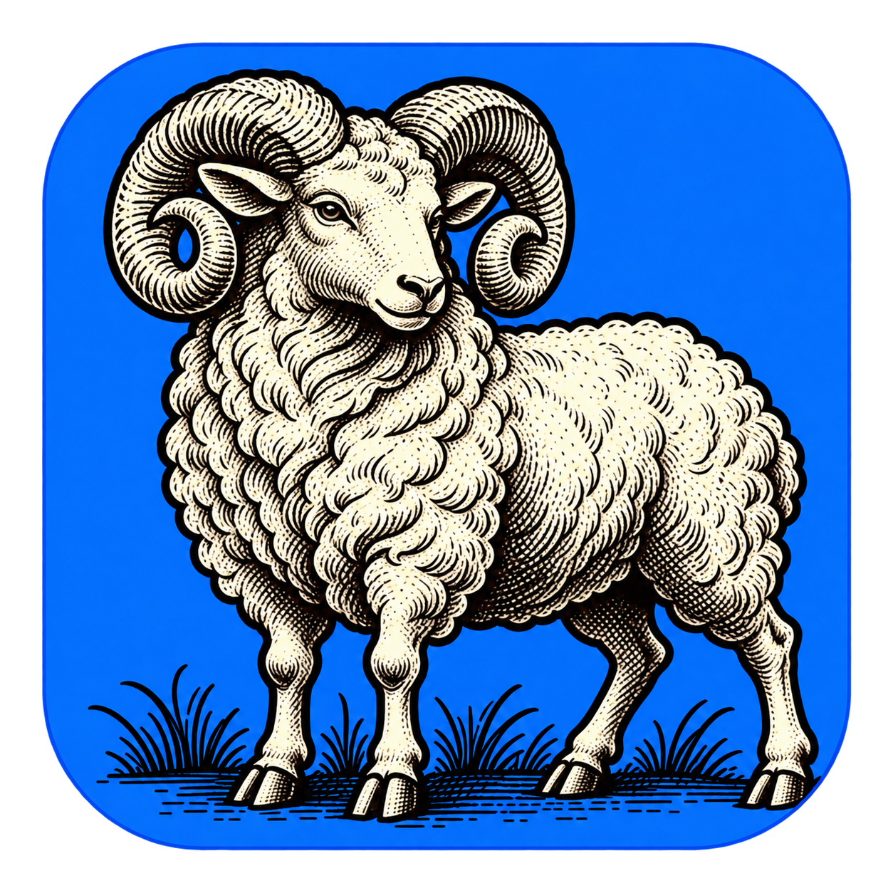

# Open JARVIS 生肖羊 Logo

  

## 设计定位

主体为十二生肖中的羊，采用具有螺旋卷角和丰厚羊毛的公羊形象。图案采用黑色轮廓、米白色高光与细密雕刻纹理，完整动物置于宝蓝色圆角底板中，图案内部没有名称文字。

这是 Open JARVIS 的品牌设计稿 v0.1，创建于 2026-10-31。图稿通过图像生成工具新绘制，并整理透明边缘；目前用于设计展示，不代表客户端或安装包已接入该图标。

## 参考与来源

用户指定参考以下同系列项目：

- [Open Office](https://github.com/ecojust/open-office)：青绿色底板的生肖牛；[品牌来源说明](https://github.com/ecojust/open-office/blob/HEAD/assets/branding/README.md)。
- [Open Media](https://github.com/ecojust/open-media)：紫色底板的生肖鸡；[品牌来源说明](https://github.com/ecojust/open-media/blob/HEAD/src/assets/branding/README.md)。

参考的是生肖动物、黑色与米白色雕刻纹理、饱和色圆角底板及主体构图比例。JARVIS 使用新生成的羊图稿与独立宝蓝色底板，未将参考项目的牛或鸡图案作为本项目的 Logo，也未把参考原图复制进本次提交。

## 原稿与导出约定

- `open-jarvis-sheep.png` 为本次设计稿母版，采用透明通道；它是位图，不标为矢量原稿。
- 图稿中的圆角、动物和底板共同构成主 Logo。显示时保持原始比例和透明边距，不再追加圆形裁切，不在羊角上覆盖状态图形。
- macOS Intel 与 arm64 从同一母版导出 ICNS；Windows x64 从同一母版导出包含多尺寸图层的 ICO。
- 界面 PNG、favicon、安装程序、Dock、任务栏使用同一主体和一致视觉占比；具体平台尺寸与容器在实施阶段统一导出。
- macOS 菜单栏和小尺寸托盘另设计同一卷角羊轮廓的简化单色版。不能直接把细密纹理缩小后就视为完成了小尺寸适配。
- 悬浮方块的聆听、执行、播报、暂停状态由外围边框、状态点及文字表达；主 Logo 不换色、不变成另一种动物。
- 导出验收检查透明边缘、浅深背景、约 112 px 的悬浮方块，以及 16、32、48、128、256 px 等尺寸的辨识度。当前未生成或验收平台图标文件。

原稿的实际尺寸与 SHA-256 记录在同目录的 `source.json`，用于后续导出时确认所用设计版本。
