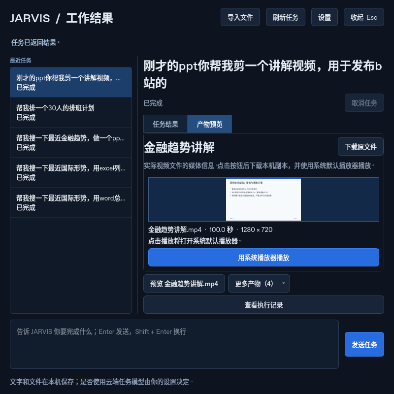

# 六项实际工作任务验收

2026-10-31，**6/6 通过文件生成与自动全屏预览验收**。实际启动独立后端、HTTP/SSE 与原生 Qt 客户端，按用户给出的顺序执行六项任务；预览均解析真实文件，报告中的 `preview_source` 为 `actual_file`。

**本轮使用明确标记的脚本化工具流程，不是大模型自主执行验收。** 当前环境没有配置任务模型：资料经检索核对后写入 [research-input.json](research-input.json)，验收脚本再次实际搜索、读取来源并调用正式工具生成文件。不能把这些预先整理的内容描述成未经配置的 JARVIS 自主研究结果。

| 任务 | 实际文件 | 客户端截图 | 本次耗时 |
| --- | --- | --- | --- |
| 国际形势 Word 总结 | [DOCX](files/国际形势总结.docx) | [正文预览](screenshots/01-word.png) | 9.30 秒 |
| 国际形势 Excel 清单 | [XLSX](files/国际形势清单.xlsx) | [表格预览](screenshots/02-excel.png) | 3.01 秒 |
| 金融趋势 PPT | [六页 PPTX](files/近期金融趋势.pptx) | [幻灯片预览](screenshots/03-ppt.png) | 8.37 秒 |
| 30 人排班 | [示例 XLSX](files/30人一周示例排班.xlsx) | [排班预览](screenshots/04-schedule.png) | 0.43 秒 |
| 刚才 PPT 的讲解视频 | [MP4](files/金融趋势讲解.mp4) · [SRT 字幕](files/金融趋势讲解.mp4.srt) · [讲稿](files/金融趋势讲解.mp4.narration.md) | [视频预览](screenshots/05-video.png) | 84.62 秒 |
| 金融总结公众号文章 | [Markdown 稿](files/金融趋势公众号文章.md) | [文章预览](screenshots/06-article.png) | 4.53 秒 |

GitHub 未内嵌显示 Office/视频文件时，使用文件页的下载原文件按钮。结果是可继续编辑的标准文件，不是改扩展名的文本。



## 检查了什么

- 共 35 次实际工具调用；4 次搜索、24 次官方页面读取，涉及 11 个唯一 URL。材料来自联合国、美联储、欧洲央行、IMF 和世界银行，资料日期与访问日期随来源保存。国际形势是选定议题摘要，金融数字区分已宣布的政策、机构预测与分析。
- 六项任务都从桌面提交，通过真实 SSE 更新状态，完成后自动进入对应的「产物预览」页。Linux offscreen 屏幕及窗口均为 800×800；后端正常退出，无 WebEngine。
- 第五项通过保存的父任务上下文找到第三项实际 PPT，越过第四项排班；脚本不能直接指定预设 PPT 路径。
- MP4 为 1280×720、24 fps、H.264/AAC，时长 99.958 秒，包含真实本地 Kokoro 中文配音。独立 FFmpeg 解码检查音轨平均音量 -26.0 dB、峰值 -8.6 dB；不是静音或测试音轨。字幕按实际音频采样长度生成。
- 排班为 30 名匿名员工、2026-11-02 起 7 天，三班各 6 人，共 126 班次、每人 4–5 班。检查每日最多一班、班间至少休息 12 小时、连续工作及总班次上限；[独立审计结果](files/30人一周示例排班.xlsx.schedule.json) 随文件提供。未提供实际姓名、技能、请假或行业规则，因此它是示例方案。

单次总耗时 111.81 秒，不是性能 P95，也不包含模型规划、语音输入和真实扬声器反馈。完整机器记录见 [report.json](report.json)，其中保存了文件 SHA-256、工具事件、来源正文哈希和逐项检查。首轮发现视频页面被长文件名与封面撑大，保留 [失败记录](initial-layout-failure.json)；修复布局后才执行本次完整重跑。

## 预览与未验证范围

Word、Excel、PPT 展示实际正文、单元格、幻灯片文字与讲稿，不是 Office 原版排版引擎。视频窗口展示实际 MP4 首帧和媒体信息，点击播放后调用系统默认播放器；不是窗口内嵌播放器。讲解画面依据 PPT 内容重排，字幕为独立 SRT。

尚未验证生产模型对六条自然语言指令的自主规划、真实显示器、麦克风和扬声器、默认播放器启动，以及三端安装后的完整工作场景。视频和文章已生成，未发布到 B 站或微信公众号。

## 复现

安装 `requirements-desktop.txt`，下载 Kokoro TTS 模型，在仓库根目录执行：

```sh
python -m jarvis --role download-tts
python scripts/acceptance_scenarios.py --research docs/acceptance/2026-10-31/research-input.json --output artifacts/acceptance-rerun
```

使用新的空输出目录；需要访问来源网站，后续页面变化或服务异常会导致真实失败。脚本只用于工具/桌面验收，不会替换产品中的 MAF 模型。截图与公开文件保留在此；用户数据库、临时令牌、运行日志及模型文件未提交。
