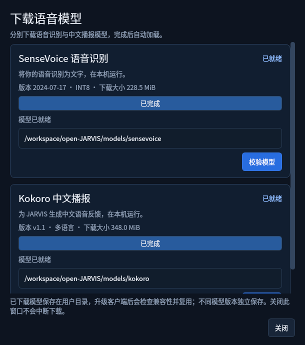
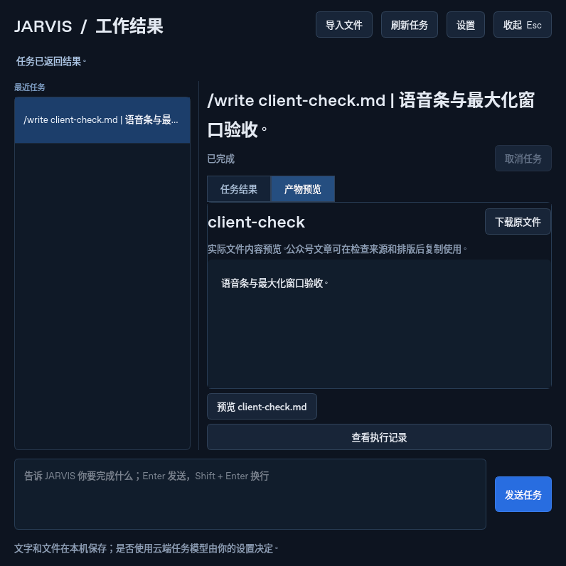

# 桌面语音条、模型按钮和最大化窗口

本轮按新的交互要求，将常驻入口改为 **320×72 语音条**：山羊 Logo、实际收音声浪、展开图标。点击条或图标采用窗口最大化，不调用系统全屏；拖动不会误展开。此前六项任务的全屏截图保留为 alpha.2 历史记录。

声浪截图来自已生成的中文讲解 MP4：实际解码 PCM，经过 WebRTC VAD 与 RMS 音量计算，再通过控制器音量事件驱动原生 Qt 语音条。它不是随机动画，也没有使用麦克风。活跃电平最多更新 12.5 Hz，静音、暂停、播报和输入异常归零；无常驻动画定时器。

「设置 → 下载与管理语音模型」提供 SenseVoice、Kokoro 下载按钮、进度、取消、重试和校验；右键菜单也能进入。截图为实际现有模型经 GUI 按钮启动独立进程、完成文件哈希校验后的状态，开发环境路径如图。没有重新下载约 605 MB 的相同权重。未下载状态、真实 HTTP 传输的受控小模型样本、取消和失败恢复另由自动测试验证。

模型与应用版本独立保存；兼容清单记录模型 ID、固定 revision、运行时格式契约和文件哈希。旧版无清单目录按固定的旧契约导入，新模型并排保存。升级默认模型、未知 ABI、同尺寸文件损坏、原子发布失败、强杀发生在新旧目录切换前后，以及锁与临时目录恢复都有回归。未知格式不会冒充已就绪，已有文件保留。真实旧模型补齐清单后仍可完成 Kokoro→SenseVoice 中文回识别。

[实际 GUI 验收报告](report.json) 覆盖：默认只出现语音条、声浪和归零、设置按钮、实际模型验证进程、当前任务结束后自动重新加载服务、真实后台写文件并最大化展示。状态断言为 `isMaximized() == true`、`isFullScreen() == false`。另有 [桌面/后端生命周期冒烟](backend-smoke.json) 验证退出后自有进程结束。

本地完整自动测试 **246 项通过**。这些检查使用 Linux offscreen Qt，不代替 macOS 真机 Spaces、真实麦克风/扬声器、屏幕缩放或持续监听性能验收。模型下载 HTTP 测试使用明确的受控小文件；GUI 核验使用真实已安装权重，不冒充再次完成整包网络下载。

开发复现：已有两个模型时运行 `python scripts/smoke_voice_bar.py --verify-installed-models`。模型应先通过客户端按钮准备；最终用户无需安装脚本。
