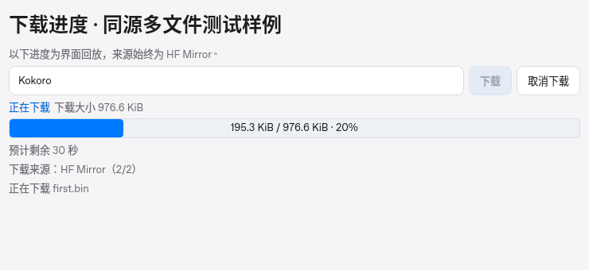
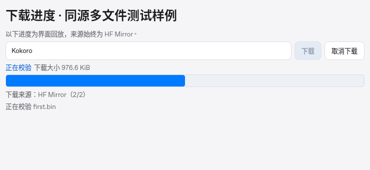
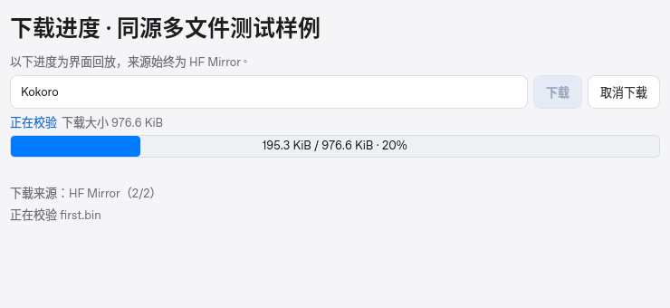

# 下载进度闪烁修复

日期：2026-10-31。旧代码基线为 `64de9f4`。本轮没有重复下载真实大模型权重。

## 原因与改动

Kokoro 有 377 个文件。此前每个文件下载结束都会强制发送 `verifying`，下一文件又发送 `downloading`；界面因此在确定百分比与滚动进度条之间切换，同时隐藏、恢复剩余时间行。即使来源始终是同一个镜像，也会产生闪烁和布局跳动。

单文件的增量 SHA-256 比较现在保留在整体下载阶段；所有文件收齐后才进入完整模型校验。普通文件边界与字节更新共用 0.2 秒刷新间隔，真实失败、换源和必须重新下载的原因仍立即显示。每个文件和最终清单的完整性检查均保留，当前健康来源继续用于后续文件。

界面在下载期间保留信息行空间，显式的中间文件校验仍保持累计百分比；最终模型校验显示独立校验阶段。校验时不显示虚假的网络剩余时间，完成后收回空位。整体校验事件清空上一文件名称，避免合并状态时误用旧文件信息。

## 真实 Qt 对照

同源合成进度事件回放，明确不是网络下载。两版界面均运行真实 Qt；[原始数据](ui-stability-report.json) 保留逐步尺寸、进度和标签状态。

| 项目 | 修复前 | 修复后 |
| --- | --- | --- |
| 连续五步行高 | 163 / 139 / 163 / 139 / 163 px | 始终 163 px |
| 中间文件校验 | 百分比变成滚动条 | 保持累计百分比 |
| 来源与详情位置 | 随 ETA 显隐移动 | 位置稳定 |

新下载器正常情况下不会再发出中间文件校验阶段；后两张通过明确标注的合成事件验证界面本身也能稳定处理这一状态。

## 下载与续传验证

新增真实本机 HTTP 验收使用 Kokoro 原有的全部 377 个文件名，但内容换成很小的合成测试字节。检查全部请求只访问同一个来源，没有换源事件；进入整体校验后不再退回下载阶段，文件和安装清单哈希通过。使用独立的进度时钟模拟同一刷新间隔内的密集文件边界，验证它们不会绕过刷新上限；HTTP/socket 时钟保持真实，避免机器速度影响测试。

真实 Qt、QProcess、限速 HTTP 的半途断流续传验收再次通过：[完整报告](resume-smoke-report.json)。源 1 在 50% 处断开，源 2 从 `Range: bytes=1725000-` 补齐，字节进度保持单调，ETA 重新估算并完成完整哈希核验。测试只使用临时合成文件，没有修改已有模型或启动语音推理。

本地 303 项测试和 ruff 通过。真实麦克风、扬声器与三端干净系统安装仍不在本轮验证范围。
