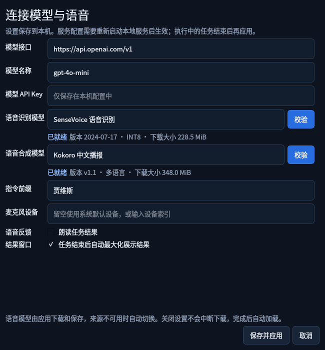
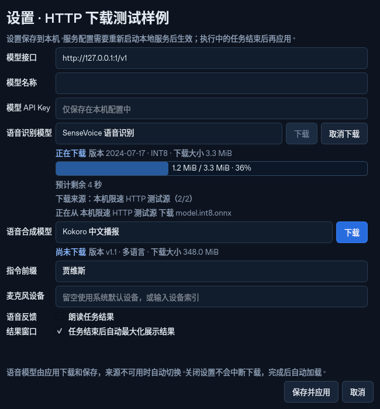

# 胶囊语音条与设置页内下载

悬浮语音条缩为 **264×56**，两端圆润，羊 Logo 以 40 px 圆形显示。点击中间声浪暂停/继续接听，键盘空格也可操作；右侧图标展开最大化结果窗口。拖动任意区域只移动位置，不误触暂停或展开。

声浪来自已有中文配音视频解码的真实 PCM/VAD 电平，图中标注「语音样例输入」，没有使用麦克风。原始品牌图片未修改，仅在原生 UI 中圆形裁切。

「设置」中原目录选择入口已替换为模型名称与「下载」，当前不提供目录选择或导入。下载、取消、重试及已安装模型校验都在对应模型行内完成，不打开额外窗口。下图为实际现有 SenseVoice/Kokoro 经设置按钮启动独立进程、校验完成后的状态。

下载中显示百分比、已下载/总大小、来源与预计剩余时间。估算使用实际传输字节及滚动速度，初始采样和换源期间显示「正在估算」；校验、安装时清除网络 ETA。关闭设置后下载继续，重开恢复显示，下载按钮不会保存其他未提交设置。

上图明确为 **本机 HTTP 测试样例**：实际 QProcess 先遇到 503，再自动切到限速 HTTP 来源，真实下载约 3.3 MiB 的合成测试文件并计算 ETA。文件经过固定哈希及安装清单校验，但不是可用语音权重，不启动推理，也未修改已有模型。不能据此宣称真实模型整包网络下载已完成。

- [桌面验收报告](desktop-report.json)：真实 PCM、声浪按钮暂停/继续、实际已安装权重校验、后台任务及最大化预览。
- [下载验收报告](download-report.json)：实际 HTTP/QProcess/Qt、来源切换、实际 ETA、关闭重开、无导入字段和无额外窗口。
- 本地完整 **281 项测试通过**，ruff 通过。验收使用 Linux offscreen Qt；真机麦克风、扬声器、macOS Spaces 和干净系统安装仍待验收。

开发复现：`python scripts/smoke_inline_download.py`；已有两个语音模型时运行 `python scripts/smoke_voice_bar.py --verify-installed-models`。这些是开发验证工具，最终用户直接点击设置中的下载按钮。
