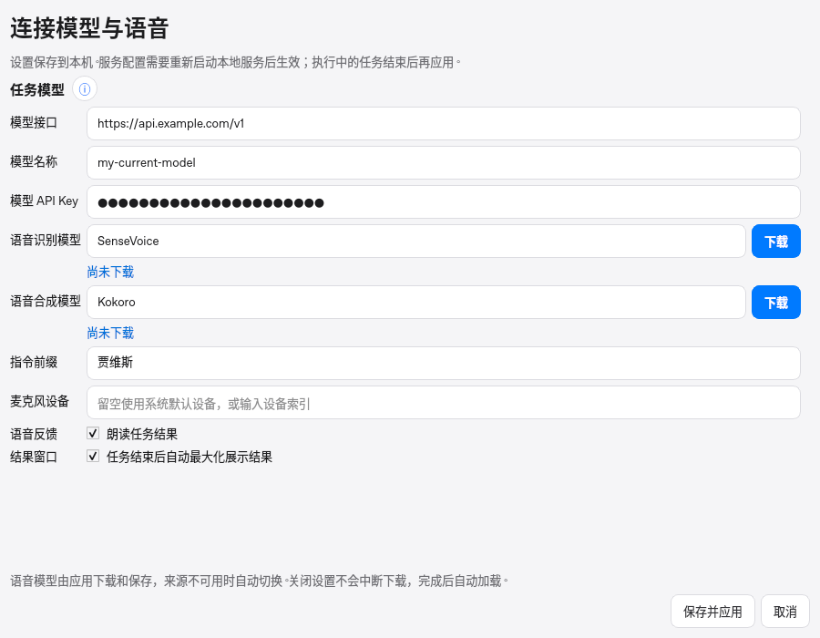
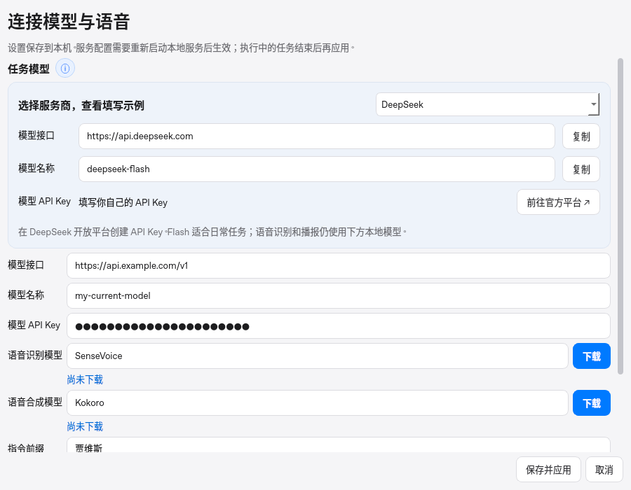
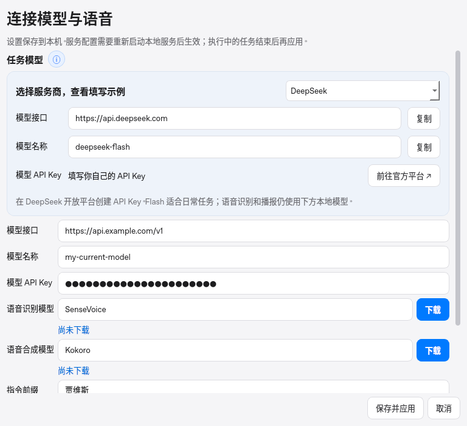
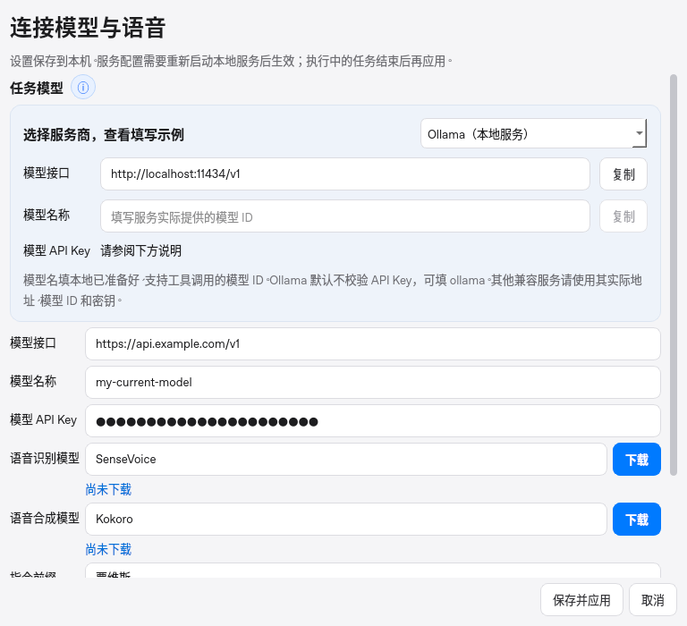

# 设置加宽与模型厂商填写帮助

日期：2026-10-31。真实 Qt 设置界面，Linux offscreen；截图中的接口、模型和被遮蔽密钥均为明确的界面测试数据，没有使用用户凭证。

## 窗口与帮助面板

常规 1280×900 屏幕上，设置窗口为 900×700，模型输入框实际宽 784 px；800×800 小屏上窗口自动缩至 768×700，输入框宽 652 px。依据真实 QScreen 可用尺寸调整，不硬编码大窗口超出屏幕；展开帮助后可垂直滚动，保存与取消按钮固定在底部。

任务模型标题旁的 ⓘ 默认收起，点击后在原设置页内显示厂商选择、接口地址、模型名称及 API Key 获取入口。可复制地址/模型或主动打开官方平台；切换与复制不会改动现有输入、保存设置或发起模型请求。

本地 Ollama 的模型 ID 取决于用户已准备的模型，因此示例留空、提示实际 ID，并禁用无效复制。无需真实密钥时提示填写 `ollama`，没有伪造的密钥申请链接。

[宽屏尺寸与交互记录](01-large-screen-metrics.json) · [小屏记录](02-small-screen-metrics.json)。新增 Qt 回归覆盖默认收起、展开/收起、切换所有厂商、复制示例、官方入口以及原三个字段与 API Key 保持不变；现有设置、模型下载与配置测试继续通过。

## 填写示例来源

帮助数据在 `jarvis/provider_help.py`，只在设置界面使用，不引入后台网络请求或浏览器引擎。以下官方文档在本轮实际访问核对，模型名称仍以各账户可用列表为准：

| 厂商 | 文档 | 示例 |
| --- | --- | --- |
| DeepSeek | [官方 API 文档](https://api-docs.deepseek.com/) | `https://api.deepseek.com` / `deepseek-flash` |
| OpenAI | [当前模型文档](https://developers.openai.com/api/docs/models/gpt-6.1-sol) | `https://api.openai.com/v1` / `gpt-6.1-sol` |
| 阿里云百炼 | [OpenAI 兼容接口](https://help.aliyun.com/zh/model-studio/compatibility-of-openai-with-dashscope) | 北京地域地址 / `qwen3.8-max`；密钥地域必须一致，官方仍允许现有通用域名 |
| Ollama | [OpenAI 兼容接口](https://docs.ollama.com/api/openai-compatibility) | `http://localhost:11434/v1` / 已安装的实际模型 ID |

## DeepSeek 工具调用适配

[官方思考模式文档](https://api-docs.deepseek.com/guides/thinking_mode) 说明当前默认开启 thinking，并要求工具后续请求回传 `reasoning_content`。当前 MAF 的通用序列化与 native 备用循环不保留此字段，因此官方 DeepSeek 端点改为明确使用非思考工具模式，兼顾现有协议和响应速度。仅对解析后的 `api.deepseek.com` 主机生效，代理和其他厂商不额外注入此参数。

本地 HTTP 模型服务明确模拟该参数要求：漏传时返回 400。实际 MAF / OpenAI SDK 流式完成总控→Writer→工具写文件→后续回答，验证每次请求均携带正确参数；native 备用流程也通过真实 HTTP 工具往返。另验证其他提供商和含伪装域名的 URL 不被误匹配。没有使用生产 DeepSeek API Key，这些检查不代表真实模型质量、可用额度或自然语言任务验收。

## 完整回归与三端构建

本地完整 301 项测试和 ruff 通过。`42fa3a2` 的 [三端原生 CI](https://github.com/ecojust/open-JARVIS/actions/runs/41199296308) 与 [alpha.7 候选安装包构建](https://github.com/ecojust/open-JARVIS/actions/runs/41199298612) 均首次通过；包含实际桌面/后端冒烟、冻结程序自检与安装包上传。[元数据](native-build.json) 记录三个产物的身份和大小。它们为未签名开发预览，未发布正式 Release；没有将上述本地测试等同于真实音频或干净系统安装验收。
