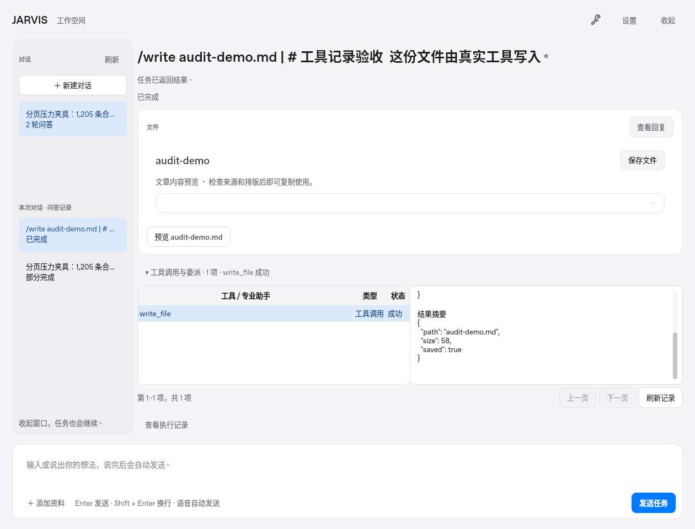
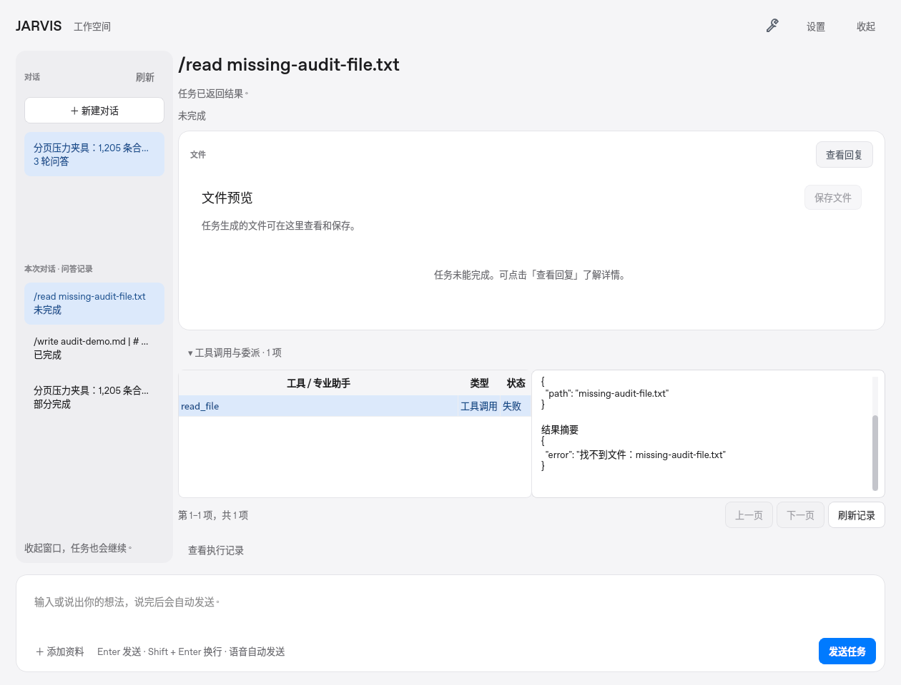
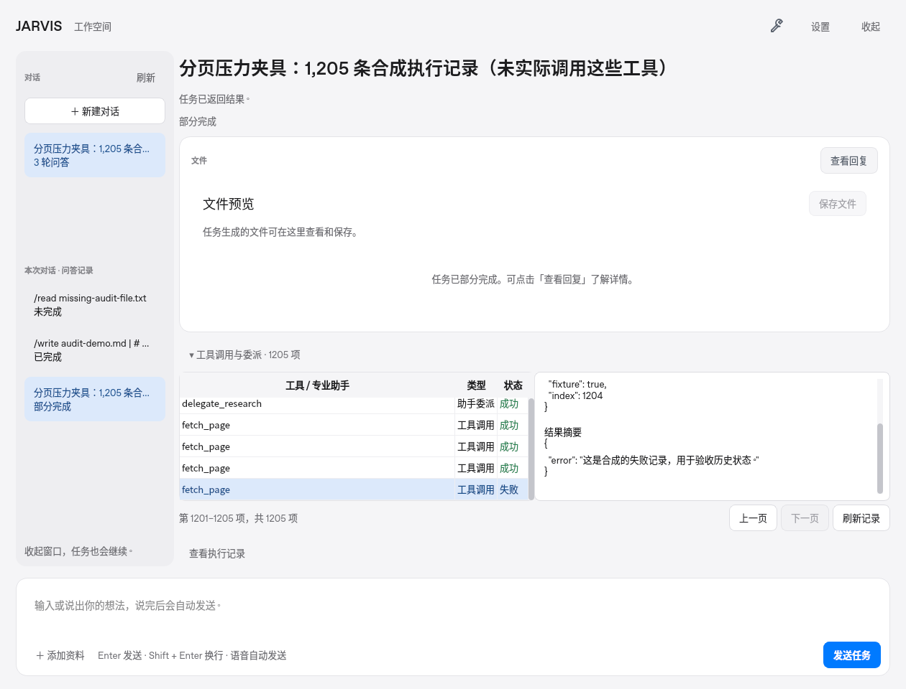

# 同一对话中各轮工具调用的展示

日期：2026-10-31。每个 run 的产物下方新增「工具调用与委派」入口，直接显示执行记录数量和最近工具状态。展开后逐项显示工具名、工具调用／助手委派、执行中／成功／失败／取消／中断；点击某一项才读取输入参数与结果摘要。完整 Agent 回答仍只在用户点击「查看回复」后显示，后台 TTS 沿用原流程。

## 实际桌面与后台验收

[ui-acceptance.json](ui-acceptance.json) 来自实际 Qt 应用、自有后台进程、HTTP/SSE 和 SQLite；使用隔离临时目录，结束后清理后台。两个 run 属于同一 session：

1. `/write audit-demo.md` 通过实际 `write_file` 写出文件；界面从真实接口读取该调用的成功状态、参数和结果。
2. `/read missing-audit-file.txt` 通过实际 `read_file` 产生缺文件错误；切换到这轮时不显示上一轮的参数或结果。
3. 记录中实际收到这两轮的持久 `tool.started` 与 `tool.completed/tool.failed` 事件。UI 只使用这些带 `step_id` 的持久事件，不重复显示 `agent.tool_*` 临时通知。
4. 工具详情保持按需展开；完整 Agent 回复未自动显示。





这两轮使用明确的 demo 工具指令，未调用外部模型或语音设备，不代表生产模型自主规划和真实麦克风／扬声器验收。

## 1,205 项历史记录与重启

分页压力部分向独立 SQLite 写入 **1,205 条明确标记的合成审计记录**，包含工具与助手委派，并让最后一条记录为失败。夹具没有执行这些工具；它用于检查真实 API、分页、展示边界与持久化。

实际 Qt 窗口读取第一页、第二页和最后一页。最后一页显示第 1,201–1,205 项，选择最后一项能读取合成失败详情。随后关闭后台及桌面控制器，保留临时数据库重新启动，再次从真实接口读取该 run 的完整记录数量和第一页。



界面每页最多保留 100 条轻量记录，使用 `QAbstractTableModel/QTableView`，没有为每次调用创建独立控件。参数和结果在单条点击后才拉取；每部分的显示摘要最多 6,000 字符，并明确标注截断。委派作为执行记录展示，不将其数量冒充实际工具调用预算。

## 并发与性能边界

[10 项工具 UI 回归](../../../tests/test_run_tools_ui.py) 在实际 Qt 控件上检查：按 run/step 隔离、嵌套委派与工具结果按 ID 配对、重复事件去重、旧请求不能覆盖新 run、历史分页、摘要懒加载与截断、取消终态校准，以及分页请求、后台 summary 和 SSE 同时返回时的状态一致性。

总数快照与当前页状态使用不同事件水位，第一页 summary 不会屏蔽第二页的完成事件。旧快照不能回滚新状态或清空新页；snapshot 之后新增的记录也不会丢失。当前检查项的状态变化只重新读取该条详情。页请求期间最多临时保留 1,024 条轻量增量，结束后释放；超过范围时明确要求刷新，避免持续重试。常驻当前页和最近增量各最多 100 条，不保存整批参数与结果。

收起面板不会解析详情，不启动轮询。展开、重开窗口或任务终态需要校准时读取当前页；终态取消只刷新一次，不为每个工具事件重新拉整轮记录。这里描述的是实现和局部验证，完整启动、内存、语音常驻性能以仓库总体验证记录为准。

复现：

```sh
python scripts/acceptance_run_tools_ui.py --output /tmp/jarvis-run-tool-evidence
```

脚本实际生成截图与 JSON，不读取用户配置，也不访问外部模型或网页。三个平台冻结安装包是否通过，需另外查阅该版本原生构建记录。

## 本轮整体验证

本地完整 390 项测试及 Ruff 通过。[30 次启动测量](performance.json)中，Linux offscreen 语音条启动 P95 238.09 ms、RSS P95 75.86 MiB；相较 alpha.10 同环境 228.90 ms 增加约 4.0%。此范围不含后端或模型，不代表三端常驻性能预算已达标。

[桌面生命周期检查](desktop-smoke.json)使用真实 Qt、后台及音频子进程，完成 API/SSE、实际写文件、匹配结果最大化与退出清理；没有打开物理麦克风、播放语音或调用云模型。

## 三端原生安装包

源码 `b26fd5b740fc14302bc707109899fb87119bee3f` 的 [原生 CI](https://github.com/ecojust/open-JARVIS/actions/runs/41220819046) 与 [alpha.11 构建](https://github.com/ecojust/open-JARVIS/actions/runs/41220818906) 均首次通过。三个平台完成测试、桌面与真实后台冒烟，再执行冻结程序自检和实际 MAF 委派、中文文件写入、回答返回检查。

[native-build.json](native-build.json) 保留实际运行时间、全部 job/step 结果和三份候选产物身份。上轮开发环境断开只中断了本地监控，GitHub 上的三端构建继续完成；2026-11-01 恢复后复核成功结果，复用原构建发布，没有重新构建或替换源码。

## 公开下载与附件核验

[alpha.11 Release](https://github.com/ecojust/open-JARVIS/releases/tag/v0.1.0-alpha.11) 已于 `2026-11-01T05:37:38Z` 公开，`draft=false`、`prerelease=true`。[发布流程](https://github.com/ecojust/open-JARVIS/actions/runs/41277620933)核对全部安装器 SHA-256、完整矩阵和冻结 MAF 任务检查后上传 9 个附件。

公开后匿名下载三份原始 manifest 与三份 SHA-256 文件，核对其内容摘要、安装器公开 digest 和源码 tag `b26fd5b740fc14302bc707109899fb87119bee3f`。这里没有重新下载或安装三端安装器；打包程序执行证据来自原生 runner。

| 目标 | 构建清单 | 安装器字节数 |
| --- | --- | --- |
| macOS Intel | [manifest](open-JARVIS-0.1.0-alpha.11-macos-x64.manifest.json) | 144,561,721 |
| macOS Apple Silicon | [manifest](open-JARVIS-0.1.0-alpha.11-macos-arm64.manifest.json) | 132,430,864 |
| Windows x64 | [manifest](open-JARVIS-0.1.0-alpha.11-windows-x64-setup.manifest.json) | 110,440,498 |

[release.json](release.json) 保存 Release ID、实际发布时间、源码提交及全部附件身份和摘要。
