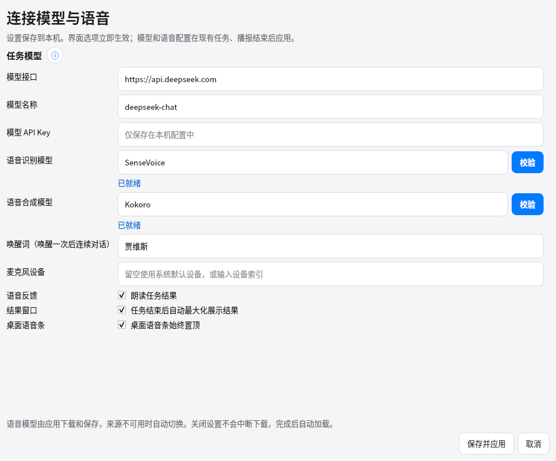

# 桌面语音条置顶设置

2026-10-31。设置增加「桌面语音条始终置顶」，默认开启。保存后立即应用并沿用窗口位置，重启恢复选择；不改变结果窗口层级、当前会话和监听状态。

`tests/test_tile_settings.py` 的 5 项测试使用真实 Qt 控件与临时设置文件，检查默认值、环境覆盖、保存与重建控制器、几何位置/可见性、活动任务和播报期间即时应用，以及模型字段变更仍按原流程延迟重载。子进程使用记录调用的测试替身，确认纯界面修改不会启动重载或发送停止语音指令；这不是物理音频设备验收。

macOS 关闭置顶时使用普通 `Qt.Window`，开启时使用 `Qt.Tool` 和 `WindowStaysOnTopHint`。[Qt 官方说明](https://doc.qt.io/qt-6/qt.html#WindowType-enum)指出 macOS 的 Tool 映射为 NSPanel，其本身高于普通窗口，因此不能只删除置顶 hint。平台分支已做 flags 测试；Linux offscreen 测试不等同于真实 macOS/Windows 窗口管理器层叠验收。
