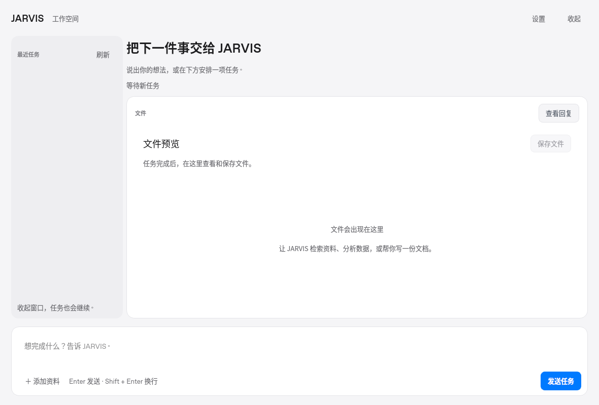
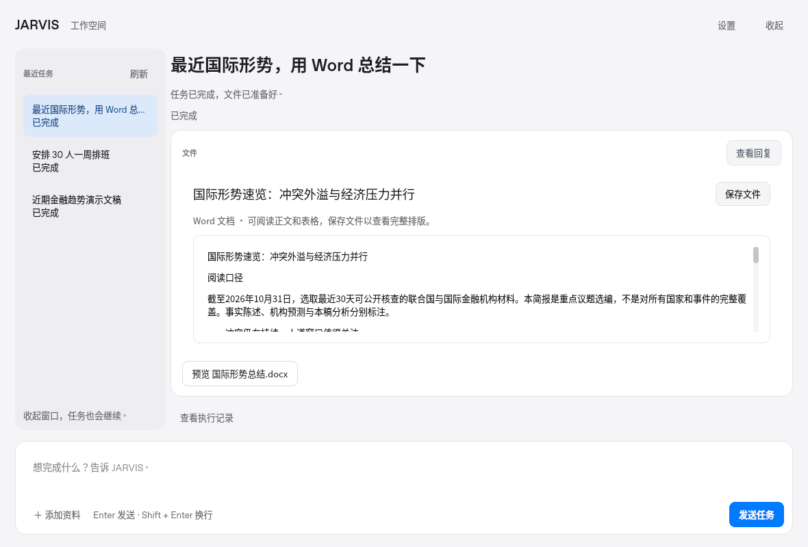
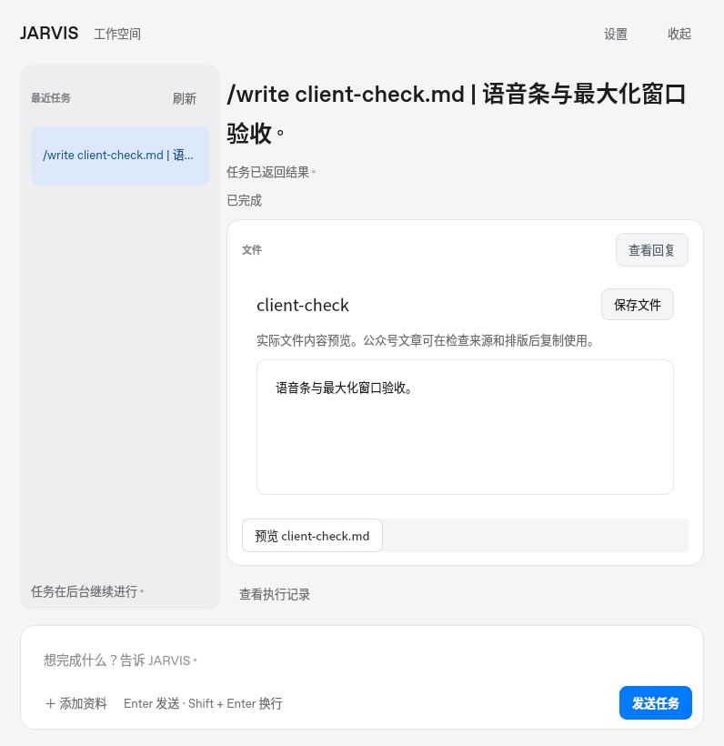
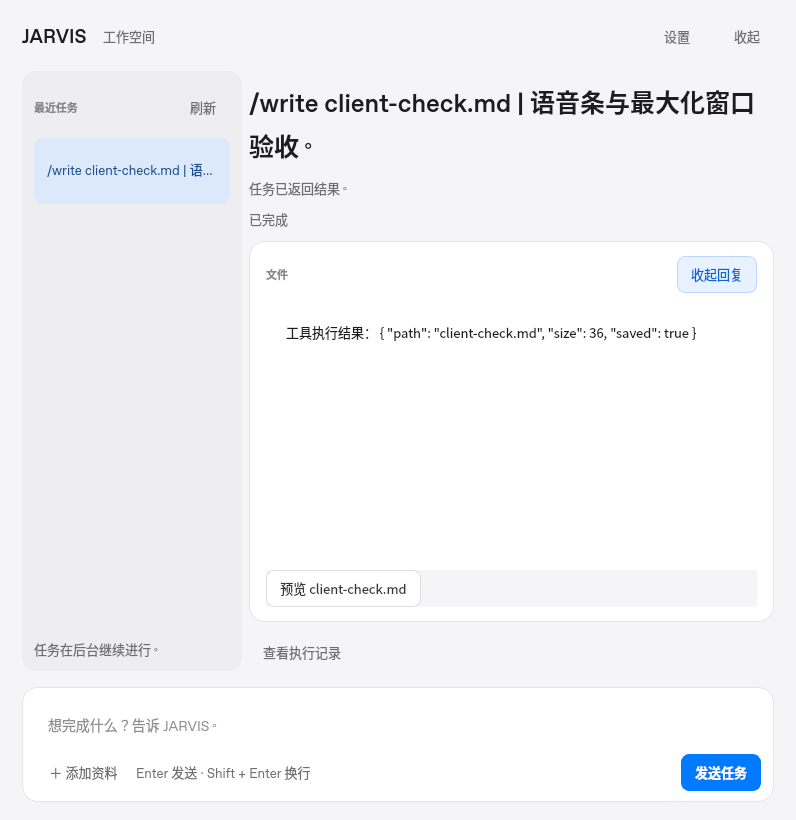
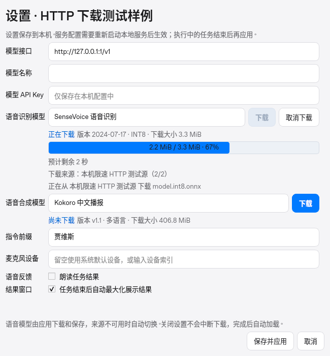
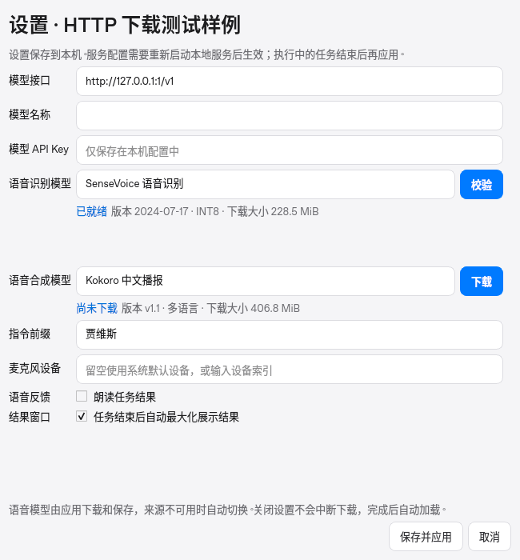

# 浅色工作空间、后台播报与模型换源续传

日期：2026-10-31。本地 Linux x86_64、Python 3.12、Qt offscreen。295 项测试及 ruff 通过；没有可用真实麦克风或扬声器。

## 工作空间

主页面使用浅色侧栏和白色文件区，保留原生 Qt 与按需加载。默认展示生成文件，完整文字回复只有点击「查看回复」后才解析显示。切换任务重新收起回复；迟到的预览不会覆盖主动打开的回复。输入框旁的「添加资料」支持 CSV、TXT、Markdown、JSON，单文件不超过 2 MB。



下图展示此前验收生成的真实 Word 文件内容；左侧任务标题和状态使用界面样例数据，并非本轮重新执行国际形势研究。



以下两图来自本轮真实客户端与本地后端，通过命令演示模式执行 `/write client-check.md`：默认显示实际文件，点击「查看回复」后才显示回答。[桌面验收报告](desktop-report.json) 同时覆盖 264×56 胶囊、声浪暂停/继续、实际 PCM 声浪、已安装模型校验和最大化窗口。没有生产任务模型参与，也未验证 macOS Spaces 或真实音频设备。





后台播报与浏览状态独立：浏览其他任务不会停止当前播放或清空队列，隐藏窗口也可继续播报。显式浏览不会被下一段播报抢走；语音补充跟随刚播报的问题，文字补充跟随当前浏览的任务。控制器回归测试使用明确的播放替身验证这些状态转换，不能作为真实扬声器验收。

## 中途断流后换源续传

真实 Qt 设置页、QProcess 和两个本机 HTTP 来源组成故障注入验收，下载内容是约 3.3 MiB 的合成测试文件，不是推理权重。首源发送一半后断流；第二源收到 `Range: bytes=1725000-`，返回 206 并只发送剩余部分。下载/换源事件的字节计数始终递增，最后完整 SHA-256 校验通过。

下图为续传到 67% 的实际设置页。剩余时间按当前源实际速度重新估算；关闭重开设置后保持同一个下载进程。[完整请求、进度与断言](inline-resume-report.json)。





另用固定版本的真实 `tokens.txt`，从本机断流点切换到真实 HF Mirror：SenseVoice 保留 157,947 字节、补齐 157,947 字节；Kokoro 保留 555 字节、补齐 556 字节。两者整文件哈希均匹配，进度未回退，见 [远端续传报告](remote-resume-report.json)。大型 ONNX 文件只探测中点 Range 响应并读取约 14 KB，两个模型均返回正确的 206 范围，见 [大文件探测](model-range-probes.json)。没有重复下载全部大权重。

Kokoro 在线来源统一为固定版本的 Hugging Face 文件及 HF Mirror，避免压缩包和分文件无法续接；模型内容、兼容契约及安装版本未变，已安装模型继续复用。服务器忽略 Range、返回错误范围、文件大小不符或整文件哈希失败时，下载器不会拼接无效响应。尝试可续传来源后仍不可用，才明确提示重新下载当前文件；重试有上限。磁盘错误、取消不触发无关换源。

本次支持同一个下载任务内的换源续传；取消或退出应用后不会保存跨进程断点。

## 复现

```sh
python scripts/run_tests.py
python -m ruff check jarvis tests scripts packaging/entrypoint.py
python scripts/smoke_voice_bar.py --verify-installed-models --output artifacts/light-workbench-check
python scripts/smoke_inline_download.py --output artifacts/workbench-resume-final
```

首个界面脚本使用已安装的真实模型做哈希校验；后一个脚本只写临时测试目录，完整结束后清理，不修改现有模型或启动推理。
